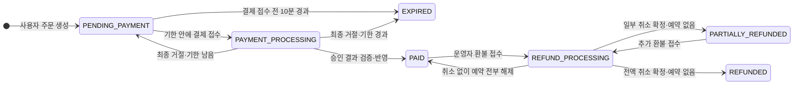
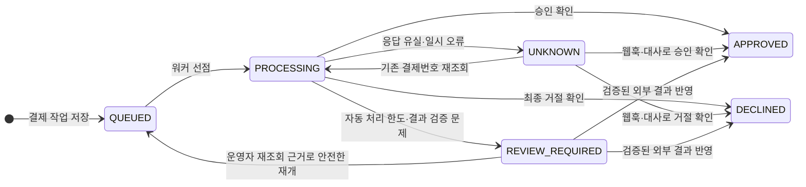
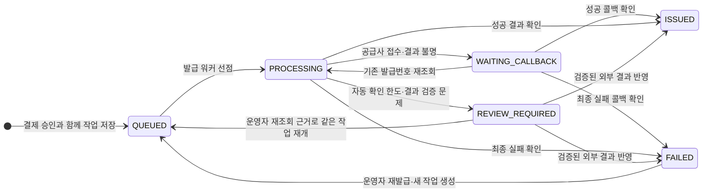
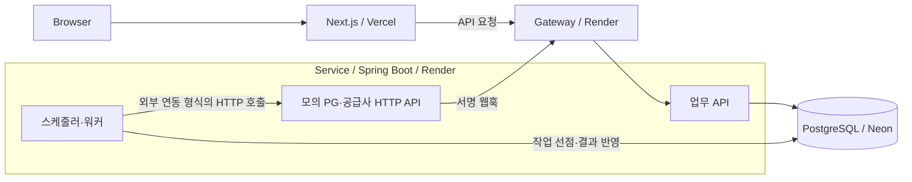
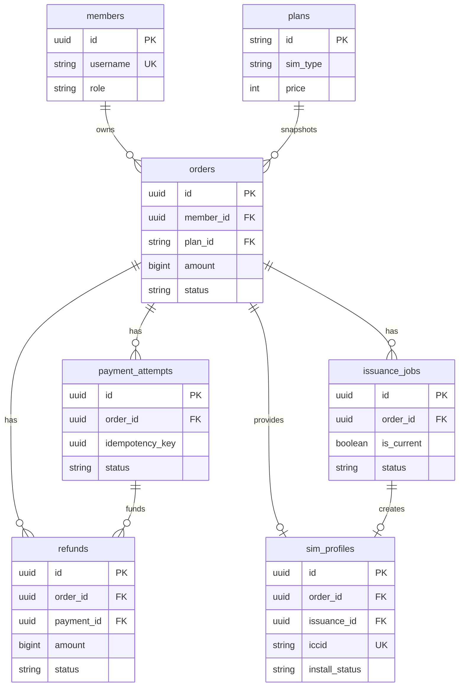

# Alpha Media
### [[실제 접속 가능한 URL]](https://alpha-media-mauve.vercel.app/)
여행용 eSIM의 주문·모의 결제·발급·설치 상태 추적과 운영자 복구를 구현한 과제 프로젝트다.

[로컬 실행](#로컬-실행-방법) · [시연 방법](#시연-방법) · [설계 질문 답변](#왜-이-기술을-골랐는가) · [아키텍처·데이터 모델](#아키텍처-개요와-데이터-모델) · [배포 기록](#배포-주소와-막혔던-지점) · [미구현·타협](#미구현타협한-부분과-이유) · [투입 시간·AI 활용](#실제-투입-시간과-ai-활용)

## 로컬 실행 방법

아래 명령은 **Windows PowerShell에서 새로 받은 저장소를 실행하는 기준**이다. Git, **Node.js 24**, **JDK 21**, **PostgreSQL 18의 명령줄 도구**를 설치하고 `git`, `node`, `npm`, `java`, `initdb`, `pg_ctl`, `psql`을 PATH에 등록한다. Maven은 각 서버의 Wrapper가 준비한다. 최초 의존성 설치에는 인터넷 연결이 필요하다.

Frontend `3000`, Gateway `8080`, Service `8081`, 평가용 DB `55432` 포트를 사용한다. DB는 프로젝트의 `.local/evaluator-postgres`에 별도로 생성하므로 기존 PostgreSQL이나 Neon 접속 정보가 필요하지 않다. 아래 코드 블록을 순서대로 실행하며, 오류가 나면 다음 단계로 넘어가기 전에 해결한다.

### 1. 저장소 받기와 의존성 설치

프로젝트를 둘 상위 폴더에서 실행한다. 이후 명령은 별도 안내가 없으면 저장소 루트인 `alpha-media`에서 실행한다.

```powershell
git clone --branch main https://github.com/S-Series/alpha-media.git
cd alpha-media
npm ci
npm --prefix frontend ci
```

### 2. 로컬 환경변수와 로그인 계정 준비

**새 클론에서 최초 한 번만 실행한다.** 아래 블록은 예제 파일을 바탕으로 Service·Frontend 설정, 무작위 DB 비밀번호·연동 키, DB 초기화 SQL을 생성한다. 기존 Service·Frontend 설정이나 평가용 DB가 있으면 덮어쓰지 않고 중단한다.

```powershell
@'
const { randomBytes } = require("node:crypto");
const { existsSync, mkdirSync, readFileSync, writeFileSync } = require("node:fs");
const targets = ["backend/service/.env", "frontend/.env.local",
  ".local/evaluator-postgres", ".local/evaluator-bootstrap.sql",
  ".local/evaluator-admin.password", ".local/fixed-accounts.json"];
if (targets.some(path => existsSync(path))) {
  throw new Error("Existing local settings found. Use a fresh clone for initial setup.");
}
mkdirSync(".local", { recursive: true });
const secret = () => randomBytes(32).toString("hex");
const values = {
  DB_URL: "jdbc:postgresql://127.0.0.1:55432/alpha_media",
  DB_USERNAME: "alpha_media_app", DB_PASSWORD: secret(),
  DB_MIGRATION_URL: "jdbc:postgresql://127.0.0.1:55432/alpha_media",
  DB_MIGRATION_USERNAME: "alpha_media_owner", DB_MIGRATION_PASSWORD: secret(),
  SESSION_COOKIE_SECURE: "false",
  MOCK_PG_ENABLED: "true", MOCK_PG_API_KEY: secret(), PG_WEBHOOK_SECRET: secret(),
  MOCK_PG_BASE_URL: "http://127.0.0.1:8081/internal/mock-pg",
  PG_WEBHOOK_URL: "http://127.0.0.1:8080/webhooks/pg",
  MOCK_SUPPLIER_ENABLED: "true", SUPPLIER_API_KEY: secret(), SUPPLIER_WEBHOOK_SECRET: secret(),
  SUPPLIER_BASE_URL: "http://127.0.0.1:8081/internal/mock-supplier",
  SUPPLIER_WEBHOOK_URL: "http://127.0.0.1:8080/webhooks/supplier",
  WEBHOOK_INBOX_ENCRYPTION_KEY: randomBytes(32).toString("base64")
};
let env = readFileSync("backend/service/.env.example", "utf8");
for (const [key, value] of Object.entries(values)) {
  env = env.replace(new RegExp(`^${key}=.*$`, "m"), `${key}=${value}`);
}
const options = { mode: 0o600, flag: "wx" };
writeFileSync("backend/service/.env", env, options);
writeFileSync("frontend/.env.local",
  "GATEWAY_BASE_URL=http://127.0.0.1:8080\nGATEWAY_REQUEST_TIMEOUT_MS=8000\n", options);
writeFileSync(".local/evaluator-admin.password", secret() + "\n", options);
writeFileSync(".local/evaluator-bootstrap.sql", [
  `CREATE ROLE alpha_media_owner LOGIN NOSUPERUSER NOCREATEDB NOCREATEROLE PASSWORD '${values.DB_MIGRATION_PASSWORD}';`,
  `CREATE ROLE alpha_media_app LOGIN NOSUPERUSER NOCREATEDB NOCREATEROLE PASSWORD '${values.DB_PASSWORD}';`,
  "CREATE DATABASE alpha_media OWNER alpha_media_owner;",
  "REVOKE ALL ON DATABASE alpha_media FROM PUBLIC;",
  "GRANT CONNECT ON DATABASE alpha_media TO alpha_media_owner, alpha_media_app;",
  "\\connect alpha_media",
  "REVOKE ALL ON SCHEMA public FROM PUBLIC;",
  "GRANT USAGE ON SCHEMA public TO alpha_media_app;"
].join("\n") + "\n", options);
console.log("Local environment files created. Secret values were not printed.");
'@ | node
if ($LASTEXITCODE -ne 0) { throw '환경변수 생성 실패' }
npm run accounts:configure
if ($LASTEXITCODE -ne 0) { throw '로그인 계정 구성 실패' }
```

고객 계정은 `customer1`, `customer2`, 운영자 계정은 `admin`, `admin2`다. 새로 생성하는 로컬 시연 계정의 비밀번호는 모두 `pass1234`다. 기존 계정 설정이 있으면 비밀번호를 유지하며 `.local/fixed-accounts.txt`에서 확인한다. 회원가입 없이 이 계정으로 로그인한다. 생성된 `.env`와 `.local` 파일은 Git에서 제외된다.

`WEBHOOK_INBOX_ENCRYPTION_KEY`는 모의 결제·공급사 웹훅을 사용할 때 필수다. **같은 DB를 계속 사용할 때는 이 키와 계정 설정을 유지한다.** 재시작할 때 위 생성 블록을 다시 실행하지 않는다. 전체 환경변수 설명은 [Service 예제](backend/service/.env.example)와 [Frontend 예제](frontend/.env.example)를 참고한다.

### 3. 평가용 PostgreSQL 생성과 시작

2단계에서 생성한 파일을 사용한다. 클러스터 생성과 SQL 적용은 최초 한 번만 수행한다. 앱 역할 `alpha_media_app`과 마이그레이션 역할 `alpha_media_owner`를 분리하며, 테이블·상품·회원은 이후 Service 시작 시 Flyway가 생성한다.

```powershell
initdb -D .local/evaluator-postgres -U postgres --encoding=UTF8 --locale=C --auth=scram-sha-256 --pwfile=.local/evaluator-admin.password
if ($LASTEXITCODE -ne 0) { throw 'PostgreSQL 초기화 실패' }
pg_ctl -D .local/evaluator-postgres -l .local/evaluator-postgres.log -o "-h 127.0.0.1 -p 55432" -w start
if ($LASTEXITCODE -ne 0) { throw 'PostgreSQL 시작 실패' }
$previousPgPassword = $env:PGPASSWORD
$env:PGPASSWORD = (Get-Content .local/evaluator-admin.password -Raw).Trim()
try {
  psql -X -h 127.0.0.1 -p 55432 -U postgres -d postgres -v ON_ERROR_STOP=1 -f .local/evaluator-bootstrap.sql
  if ($LASTEXITCODE -ne 0) { throw 'DB와 역할 생성 실패' }
} finally {
  $env:PGPASSWORD = $previousPgPassword
}
```

### 4. Service 실행

새 터미널을 저장소 루트에서 열고 실행한다. **Service 폴더를 작업 디렉터리로 사용해야 해당 폴더의 `.env`를 읽는다.** `Started ServiceApplication` 로그와 포트 `8081`의 기동을 확인한다. 최초에는 Flyway가 마이그레이션을 적용한다.

```powershell
cd backend/service
.\mvnw.cmd spring-boot:run
```

### 5. Gateway 실행

Service 터미널을 유지한 채, 다른 터미널을 저장소 루트에서 열고 실행한다. 기본 설정으로 `8080`에서 요청을 받아 `http://127.0.0.1:8081`의 Service로 전달한다.

```powershell
cd backend/gateway
.\mvnw.cmd spring-boot:run
```

### 6. 프론트엔드 실행

세 번째 터미널을 저장소 루트에서 열고 실행한다. 앞서 만든 `frontend/.env.local`의 주소로 `/api` 요청을 Gateway에 중계한다. 환경변수를 변경했다면 Next.js를 재시작한다.

```powershell
npm run dev
```

[http://localhost:3000](http://localhost:3000)에 접속한다. 고객은 `/plans`에서 eSIM 상품을 고른 뒤 로그인해 주문할 수 있고, 운영자로 로그인하면 `/admin/orders`로 이동한다. 결제와 공급사는 로컬 모의 시스템이며 실제 과금·통신사 발급은 수행하지 않는다.

### 7. 기동 확인과 로그인 정보

세 서버가 실행된 뒤 별도 터미널의 저장소 루트에서 확인한다. 마지막 요청은 프론트엔드 → Gateway → Service → DB의 상품 조회가 연결되는지 검사한다.

```powershell
Invoke-RestMethod http://127.0.0.1:8081/health
Invoke-RestMethod http://127.0.0.1:8080/health
Invoke-RestMethod http://localhost:3000/api/plans
Get-Content .local/fixed-accounts.txt
```

### 종료와 다음 실행

각 앱 터미널에서 `Ctrl+C`로 종료한 뒤, 저장소 루트에서 평가용 DB를 중지한다. DB 데이터와 생성한 설정은 남는다.

```powershell
pg_ctl -D .local/evaluator-postgres -m fast -w stop
```

다음 실행에서는 환경변수·DB를 다시 생성하지 않고 아래 명령으로 DB만 시작한 뒤, **4~6단계**의 세 앱을 각각 실행한다.

```powershell
pg_ctl -D .local/evaluator-postgres -l .local/evaluator-postgres.log -o "-h 127.0.0.1 -p 55432" -w start
```

위 안내는 로컬 실행용이다. 배포 환경의 HTTPS·내부 Gateway 키·Neon 연결은 [배포 안내](docs/deployment.md)를 참고한다.

## 왜 이 기술을 골랐는가?

### Frontend

Next.js는 과제의 필수 조건이었으며, 라우터는 기본 App Router 구성을 사용했다.

사용자와 관리자가 같은 로그인 체계를 사용하도록 구성했다. 마이페이지 진입 시 서버가 확인한 역할이 `ADMIN`이면 `/admin/orders`로 이동한다. 로그인과 권한 확인을 백엔드에서 수행하도록 하려는 의도였으며, 관리자 API도 백엔드에서 매 요청의 세션과 역할을 검사한다. 공통 진입점 자체가 보안을 보장하는 것은 아니다.

상품·주문 화면의 초기 데이터는 페이지 진입 시 Next.js 서버에서 조회한다. 이후 변하는 상태는 브라우저에서 API를 폴링해 갱신한다. 운영자 주문 상세는 정상 응답 후 평상시에는 5초, 발급·환불 등 진행 중 작업이 있으면 1.5초 간격으로 다시 조회한다. 처리 중에는 조회 간격을 줄여 오래된 상태가 화면에 남는 시간을 줄이려 했다. 운영자 주문 목록은 자동 폴링 없이 조회 버튼으로 갱신한다.

### Backend

Spring은 과제의 필수 조건이었고, 이번 과제에서 처음 사용했다.

DB 접근은 구현 과정에서 제안받은 `JdbcTemplate`을 사용했다. 사용하면서 주문 상태를 조건부로 갱신하거나, 행 잠금과 작업 선점 쿼리를 직접 표현할 수 있다는 장점을 이해했다. SQL과 잠금 범위를 코드에서 확인하기 좋았지만, 쿼리와 조회 결과 매핑은 직접 관리해야 했다. 실제 잠금과 동시성 제어는 PostgreSQL이 수행한다.

비동기 처리는 구현 과정에서 제안받은 DB 작업 테이블과 Spring 스케줄러·워커 방식을 사용했다. 적용하면서 별도 메시지 브로커 없이 작업을 관리하고, 서버 재시작 후에도 DB에 저장된 작업을 이어갈 수 있다는 장점을 이해했다.

요청을 접수하면 업무 상태와 후속 작업을 DB에 저장한 뒤 응답하고, 워커가 PG·공급사 호출과 결과 반영을 이어간다. 사용자가 브라우저를 닫아도 접수된 작업은 서버에서 처리한다. 서버가 꺼진 동안에는 실행이 멈추지만, 재시작 후 저장된 작업을 복구할 수 있다.

### Gateway

Gateway 분리는 시스템 설계에서 필요한 단계라고 판단해 적용했다. 고객·관리자 API와 PG·공급사 웹훅의 엔트리포인트를 Gateway로 모았다. 브라우저가 업무 서버인 Service의 URL을 직접 다루거나 호출하지 않도록 하고, 외부에서 들어오는 업무 요청을 공통 진입점에서 받으려는 의도였다.

브라우저는 Next.js의 `/api` 경로를 통해 Gateway에 요청하고, PG·공급사 웹훅은 Gateway의 `/webhooks` 경로로 들어온다. Gateway는 이 요청들을 Service로 전달한다.

Service 주소를 브라우저 코드에 넣지 않는 것만으로 접근이 차단되는 것은 아니다. 현재 Render 배포에서는 Service도 공개 주소를 가지므로 Gateway의 내부 공유 키를 검사하고, 사용자 세션과 관리자 권한은 Service에서 별도로 검증한다.

### Database

PostgreSQL은 지원한 회사에서 사용하는 DB이기 때문에 선택했다.

### 배포 호스팅

프론트엔드는 Vercel을 사용한다. 개인 포트폴리오 프로젝트에서도 사용하고 있어 배포 방식과 환경 설정에 익숙했기 때문이다. 또한 `develop` 브랜치의 커밋을 Preview로 빌드·배포할 수 있어, 실제 배포 환경에서 테스트한 뒤 `main`에 병합하는 작업 흐름을 구성하기 편했다.

서버와 DB의 배포는 처음에 Railway를 고려했다. 이전 사용 경험이 있었고, PostgreSQL도 제공하므로 서버와 DB를 같은 서비스에서 함께 관리할 수 있을 것으로 생각했다. 그러나 배포를 준비하던 당시 Railway의 이슈로 신규 스페이스 생성이 일시 중단되어 진행하지 못했다.

대안으로 이전에 사용한 경험이 있는 Render와 Neon을 선택했다. Gateway와 Service는 Render에, PostgreSQL은 Neon에 배포했다.

### 직접 추가한 주요 라이브러리

별도로 직접 선정해 추가한 주요 라이브러리는 없다. 구현 과정에서 제안받아 사용한 구성은 위의 DB 접근과 비동기 작업 방식에 설명했다.

## 결제부터 발급까지의 주문 상태 설계

현재 구현된 eSIM 구매 흐름을 정리한다. PG와 SIM 공급사는 모의 HTTP 시스템이며 실제 결제·단말용 eSIM을 제공하지 않는다. 주문, 결제 시도, 발급 작업을 별도로 저장해 결제 완료와 SIM 제공 완료를 구분한다.

### 상태와 허용 전이

주문은 `PENDING_PAYMENT`, `PAYMENT_PROCESSING`, `PAID`, `EXPIRED`로 결제 진행을 표현한다. 환불을 접수한 뒤에는 `REFUND_PROCESSING`, `PARTIALLY_REFUNDED`, `REFUNDED`로 금전 상태를 표현한다.



미결제 주문의 유효 시간은 생성 후 정확히 10분이다. 결제 접수 후 결과가 불명확한 주문은 기한이 지났다는 이유만으로 만료시키지 않고 `PAYMENT_PROCESSING`을 유지한다. 이미 접수한 결제가 있는 동안 새 결제는 차단한다.

결제 시도는 아래 상태로 구분한다. `UNKNOWN`은 타임아웃 등으로 결과를 확인하지 못한 상태이며, 최종 거절인 `DECLINED`와 다르다.



승인 반영 시 결제의 `APPROVED`, 주문의 `PAID`, 최초 발급 작업의 `QUEUED`를 같은 트랜잭션으로 저장한다. 발급 성공 시에는 SIM 프로필 생성과 발급 작업의 `ISSUED` 전환을 함께 저장한다.



웹훅이 HTTP 응답보다 먼저 도착할 수도 있으므로, `QUEUED`를 포함한 미확정 결제·발급 상태도 검증된 최종 결과로 확정할 수 있다. 위 발급도의 `FAILED → QUEUED`는 실패한 행을 되돌리는 것이 아니라, 과거 작업을 보존하고 새 현재 작업을 만드는 흐름이다. 이미 확정된 결과를 뒤집는 통지는 충돌로 기록해 추가 처리를 차단한다.

### 결제됐지만 발급되지 않은 주문은 누가 처리하는가?

이 주문의 결제는 `APPROVED`, 주문은 `PAID`이며, 별도의 발급 작업이 대기·처리 중·실패·확인 필요 상태를 가진다. 발급 완료 후에도 주문은 `PAID`를 유지하며, 제공 완료 여부는 발급 작업의 `ISSUED`와 SIM 프로필로 판단한다.

- **사용자 요청:** 주문과 결제를 접수한다. 사용자가 발급 완료까지 페이지를 열어두거나 별도 발급 요청을 보낼 필요는 없다.
- **스케줄러·워커:** 저장된 발급 작업을 선점해 공급사에 요청하고, 응답·콜백 누락 시 기존 요청번호로 결과를 조회한다. 주기적 대사도 기존 거래의 누락된 결과를 확인한다.
- **콜백:** Gateway로 들어온 서명 검증된 결과를 영속 수신함에 저장하고, 처리 워커가 결제·발급 상태에 반영한다. 성공 결과는 프로필 생성으로, 확정 실패는 `FAILED`로 끝낸다.
- **운영자:** 확정 발급 실패에서는 사유를 남겨 재발급 또는 환불을 접수한다. 결과 불명인 `REVIEW_REQUIRED`에서는 기존 거래를 재조회하고 근거와 현재 상태가 허용할 때만 같은 작업을 재개한다. 외부 결과 충돌은 임의로 덮어쓰지 않는다.

### 결제 직후 브라우저를 닫으면?

서버가 접수해 DB에 커밋한 작업은 브라우저 종료와 독립적으로 처리된다. 응답을 받지 못했더라도 접수됐을 수 있으므로 기존 요청 키·거래번호로 결과를 확인한다. 서버가 꺼지면 실행은 멈추지만, 재시작 후 미처리 작업과 만료된 실행 소유권을 복구한다. 화면의 폴링은 결과 표시를 위한 것이며 발급 실행 조건이 아니다.

상세 설계는 [결제·발급·환불 시스템 전체 설계](docs/payment-failure-flows.md)를 참고한다. 특히 **1절 전체 흐름과 상태**, **5절 만료·워커·재시도**, **6절 eSIM 발급과 재발급**, **10절 대사와 운영자 복구**에 처리 조건과 복구 경로가 있다. 상세 문서에는 USIM 등 목표 설계도 포함되어 있으며, 위 요약은 현재 구현된 eSIM 흐름에 한정한다.

## 중복 처리를 어떻게 막았고, 어떻게 증명했는가?

유니크 제약, 행 잠금, 조건부 갱신을 함께 사용했다. 같은 요청의 반복, 서로 다른 요청의 동시 실행, 허용되지 않은 상태 변경을 각각 막기 위한 선택이다.

### 유니크 제약과 멱등키

같은 요청이 여러 번 들어와 결제·발급이 반복되는 것을 막으려고 요청별 멱등키를 사용했다. 주문은 `(member_id, idempotency_key)`, 결제 시도는 `(order_id, idempotency_key)`를 유일하게 관리한다. 같은 키와 같은 조건이면 기존 결과를 반환하고, 같은 키에 다른 조건을 보내면 `409 IDEMPOTENCY_CONFLICT`로 거절한다.

외부 통지도 수신함의 `(source, event_id)` 유니크 제약으로 중복 저장을 막는다. 결제·발급 결과의 이벤트 ID, PG 거래번호, SIM 프로필의 주문·발급 ID·ICCID에도 중복 제약을 둔다. 같은 이벤트 ID의 내용이 달라지면 단순 중복으로 무시하지 않고 충돌로 기록한다.

DB의 유니크 제약만으로 외부 PG 호출까지 원자적으로 막을 수는 없다. PG·공급사에는 기존 결제·발급 요청 ID를 재사용하고, 응답 유실 후에는 같은 참조로 조회한다. 따라서 외부 시스템의 멱등 처리와 내부 DB 제약을 함께 사용한다.

### 행 잠금

두 관리자가 같은 주문을 동시에 조치하거나, 사용자 요청·워커·콜백이 같은 데이터에 접근할 때 서로의 판단이 꼬이지 않도록 행 잠금을 사용했다. 주문을 먼저 잠근 뒤 관련 결제·발급 기록을 잠그고 현재 상태를 다시 검사한다. 동일한 키를 쓴 요청뿐 아니라 서로 다른 키로 들어온 재발급·환불 요청도 현재 업무 조건에 따라 제어한다.

워커는 `FOR UPDATE SKIP LOCKED`로 다른 워커가 선점한 작업을 건너뛰고, 실행 소유권 토큰과 기한인 lease를 저장한다. 결과 반영 시 토큰을 검사해 이전 워커의 늦은 응답이 현재 작업을 덮어쓰지 않게 한다.

### 조건부 갱신과 변경 이력

갱신 가능한 상태인지 판단하고, 허용된 데이터만 변경하기 위해 조건부 갱신을 사용했다. 예를 들어 결제 접수는 `status = 'PENDING_PAYMENT'`이고 `expires_at > clock_timestamp()`인 주문만 `PAYMENT_PROCESSING`으로 바꾼다. 갱신된 행이 1개일 때만 접수 성공으로 판단한다. 주문에 고정한 상품 조건·가격은 유지하고, 해당 전이에 필요한 상태와 변경 시각을 갱신한다.

문제 발생 후 변경을 추적할 수 있게 하려는 의도는 감사 이력으로 보완했다. 조건부 갱신은 허용된 전이를 보장하고, `order_history`에는 상태 변경 전후 값·실행자·출처·사유·시각을 별도로 남긴다. 이력은 상태 변경과 같은 트랜잭션에서 저장된다.

### 세 방법을 함께 사용한 이유

유니크 제약은 중복 기록을 막지만 서로 다른 키의 요청이 같은 주문 상태를 바꾸려는 경합까지 처리하지는 않는다. 행 잠금으로 현재 상태 판단을 순서대로 수행하고, 조건부 갱신으로 실제 변경 시점의 허용 상태와 기한을 검사했다. 세 방법 중 하나만 고르거나 나머지를 버린 것이 아니라 역할에 맞게 조합했다.

### 동시 요청 검증

[주문 통합 테스트](tests/orders.integration.test.mjs)에서 실제 Gateway·Service와 별도의 임시 PostgreSQL을 실행한다. `Promise.all`로 같은 요청이나 통지 20개를 동시에 전송하고, HTTP 응답뿐 아니라 DB 기록과 모의 외부 시스템의 실행 횟수도 검사한다.

2026-10-23에 아래 4개 테스트를 실행해 모두 통과했다. 실행 중인 서버 JAR의 파일 잠금을 피하려고 현재 백엔드 소스와 테스트의 별도 복사본에서 두 서버를 빌드·검증했다. 기존 개발 DB나 Neon 대신 테스트 전용 임시 DB를 사용했다.

| 검증 대상 | 입력·장애 조건 | 확인한 결과 |
|---|---|---|
| 결제 요청 멱등성 | 같은 키로 20개 동시 요청 | 결제 시도 1개, PG 승인 실행 1회, 최초 접수 1건·재전송 응답 19건 |
| 결제 통지 중복 | 예약 웹훅 2회와 같은 결과 20개 동시 전송 | 결제 이벤트 1개, PG 승인 실행 1회, 주문 `PAID` |
| 공급사 콜백 중복 | 예약 콜백 20회와 같은 결과 20개 동시 전송 | SIM 프로필 1개, 해당 발급 이벤트 1개, 외부 발급 실행 1회 |
| 처리 전 웹훅 저장·재시작 | 처리 워커를 지연시킨 상태에서 통지 20개 동시 전송 후 재시작 | 수신 기록 1개, 재시작 후 결제 이벤트·발급 작업 각각 1개, PG 승인 실행 1회 |

실제 TAP 출력의 요약은 다음과 같다. 위 4개 테스트의 결과이며 전체 통합 테스트의 실행 결과는 아니다.

```text
# tests 4
# suites 0
# pass 4
# fail 0
# cancelled 0
# skipped 0
# todo 0
# duration_ms 45006.349
```

재현하려면 Java 21, Node.js, PostgreSQL 도구인 `initdb`, `pg_ctl`, `psql`을 PATH에 준비하고 두 서버 JAR을 빌드한 뒤, 프로젝트 루트에서 아래 명령을 실행한다. JAR을 직접 실행 중인 서버가 해당 파일을 잠그고 있다면 이번 검증처럼 별도 소스 복사본에서 빌드한다.

```powershell
.\backend\service\mvnw.cmd -f backend/service/pom.xml package
.\backend\gateway\mvnw.cmd -f backend/gateway/pom.xml package
$pattern = 'webhook inbox persists one encrypted receipt|payment same-key concurrency|payment signed duplicate webhook|issuance delayed duplicate callbacks'
node --test --test-reporter=tap --test-concurrency=1 "--test-name-pattern=$pattern" tests/orders.integration.test.mjs
```

HTTP 요청이나 콜백 전송 자체가 한 번만 발생한다는 보장은 아니다. 위 검증은 반복 전송을 허용하면서 모의 외부 거래와 내부 업무 결과가 중복 생성되지 않는지 확인한다. 실제 PG·공급사 연동에는 사업자가 제공하는 멱등 처리와 조회 계약의 별도 검증이 필요하다.

## 트랜잭션 경계는 어디에 그었는가?

PG·공급사 HTTP 호출은 DB 트랜잭션 밖에서 수행한다. 외부 응답을 기다리며 DB 연결과 잠금을 점유하지 않기 위해서다. 결제 승인 반영 시에는 결제 결과·주문 상태·발급 작업을 함께 저장하고, 발급 성공 시에는 발급 결과와 SIM 프로필을 함께 저장한다.

공급사가 접수한 뒤 DB 저장에 실패하면, 미리 저장한 발급 요청번호로 결과를 조회해 복구한다. 조회에서 기록이 없으면 같은 번호로 재요청하며 공급사의 멱등 처리로 중복 발급을 막는다. 오류 기록도 실패하면 lease 만료 후 재확인하고, 자동 처리 한도를 넘으면 운영자 확인 대상으로 남긴다.

결제 버튼 연타와 타임아웃 후 재시도에는 같은 멱등키를 재사용한다. 서로 다른 키의 동시 요청은 주문 행 잠금과 상태 검사로 제어한다. 외부 PG 호출에는 기존 결제 시도 ID, 공급사 호출에는 기존 발급 요청 ID를 유지한다.

## 사용자가 SIM을 설치했다는 판단의 근거

화면에서 활성화 정보를 열람한 사실은 서비스가 직접 `QR_VIEWED`로 기록하며, 설치 증거로 사용하지 않는다. 설치는 공급사의 `INSTALLED`, 개통은 `ENABLED` 신호를 콜백 또는 상태 조회로 확인해 각각 `INSTALLED`, `ACTIVE`로 반영한다. 현재는 모의 공급사 기준이며 실제 통신 사용량을 확인하는 것은 아니다.

공급사 신호는 주문·발급 요청·ICCID를 대조하고 이벤트 ID·버전·설치·개통 시각의 일관성을 검사한다. 중복은 한 번만 반영하고, 늦은 이전 버전은 상태를 되돌리지 않는다. 이는 신호의 일관성을 검사하는 것으로, 공급사 원천 정보 자체의 정확성을 독립적으로 증명하지는 않는다.

콜백 누락·지연은 서버의 주기 조회로 보완한다. 발급된 프로필 중 삭제되지 않고 조회 예정 시각이 된 건을 대상으로, 정상 확인 후 미설치·설치는 5초, 사용 중은 60초, 만료 후는 1시간 간격으로 다음 조회를 예약한다. 공급사 조회 실패 시에는 30초 뒤 재조회한다.

공급사 조회나 화면의 API 조회가 실패해도 설치 상태를 실패로 바꾸지 않고 마지막 확인 상태를 유지한다. 고객 SIM 상세와 운영자 주문 상세에는 공급사 마지막 확인 시각과 확인 지연·조회 오류를 표시해, 이전 상태와 최신 조회 실패를 구분한다.

## 어드민과 사용자 화면에서 서버와 클라이언트의 경계는 어디인가?

최초 로그인 확인과 상품·주문 데이터 조회는 Next.js 서버 컴포넌트에서 수행한다. 서버 조회 함수는 `server-only`로 분리하고 `cache: "no-store"`로 조회하며, 회원 인증이 필요한 API에는 세션 쿠키를 Gateway로 전달한다. 관리자 화면 진입 시 역할을 확인하지만, 실제 API의 세션·권한·주문 소유권과 업무 상태 검증은 Spring Service가 담당한다.

클라이언트 컴포넌트는 결제·환불 등의 입력, 요청 중 버튼 제어, 멱등키 유지와 결과 표시를 담당한다. 브라우저는 같은 출처의 `/api`로 요청하며, PG·공급사 호출과 발급·환불 실행은 서버가 수행한다. 버튼 클릭 후의 접수 성공과 실제 업무 완료를 구분한다.

결제·발급 대기 화면은 폴링으로 결과를 받는다. 결제는 `QUEUED`, `PROCESSING`, `UNKNOWN` 등 확인 중일 때 정상 조회 후 1.5초 간격으로 다시 확인하고, 승인·거절 확인 시 `router.refresh()`로 서버의 주문 화면도 갱신한다. 발급은 결제 확인 중·완료 주문에서 조회하며 `ISSUED`, `FAILED`, `REVIEW_REQUIRED`에 도달하면 자동 조회를 멈춘다. 그전에는 정상 조회 후 1.5초 간격으로 확인하며 수동 재조회도 제공한다.

운영자 주문 상세는 발급·환불·웹훅 처리·복구 등의 진행 중 작업이 있으면 정상 조회 후 1.5초, 그 외에는 5초 간격으로 갱신한다. 주문 목록은 서버에서 조회하고 조회 버튼으로 갱신한다. 조회 오류가 나면 마지막 확인 데이터를 유지하고 오류를 별도로 표시한다.

운영자 상세에는 서버 응답의 `checkedAt`을 KST로 표시하고, 브라우저가 매초 계산한 `몇 초 전`을 함께 보여준다. 이는 마지막 서버 조회 이후 지난 시간이며 외부 공급사 상태의 최신성을 보장하는 값은 아니다. SIM의 공급사 마지막 확인 시각은 별도로 표시한다. 고객 결제·발급 패널에도 마지막 조회 시각을 표시해 조회 실패와 실제 업무 상태를 구분한다.

## 이번 과제에서 처음 써본것

### Spring Boot
주로 AI의 도움을 받아 구현했고, 모르는 용어나 동작 방식은 질문하면서 익혔다. 이미 만들어본 TS 서버를 간단하게 Spring으로 만들어보여 감각을 익혔다. 해당 과정은 약 4시간 소요되었다. 
기본적인 틀을 작성하는것도 익숙하지 않아, AI가 문법등 틀린점을 많이 잡아주었다.

## 시간이 있었다면 무엇을 더 했을것인가?

### 1. Spring Boot를 더 깊게 공부

Spring Boot를 처음 사용하면서 AI의 도움을 많이 받았기 때문에, 구현한 코드의 동작을 스스로 이해하고 설명할 수 있도록 더 공부하고 싶다. 특히 트랜잭션과 비동기 작업이 실행되는 방식을 깊게 익혀, 기능을 직접 수정하고 문제의 원인을 판단할 수 있는 기반을 갖추는 것을 우선하고 싶다.
또한, 지원한 회사의 주요 기술 스택일것으로 예상되기에 더욱 깊게 공부해보고 싶다.


### 2. USIM 시스템 끝까지 구현 

현재 USIM은 상품 조회와 안내까지만 구현되어 있다. 시간이 더 있었다면 주문·결제부터 공항 수령, ICCID 등록, 공급사 개통까지 연결해 기획한 구매 흐름을 끝까지 완성하고 싶다. eSIM뿐 아니라 USIM을 선택한 사용자도 실제 구매 과정을 진행할 수 있게 만드는 것이 다음 우선순위다.


### 3. 주문, 결제, 발급 시스템 흐름을 더욱 더 세분화

현재도 결제 흐름을 파악하고 그 과정에서 발생할 수 있는 이슈를 찾으려고 노력했다. 다만 아직 놓친 상황이 있을 수 있다고 생각한다. 시간이 더 있었다면 주문·결제·발급 흐름을 더 공부하고, 각 단계에서 발생할 수 있는 실패와 복구 경로를 세분화해 검토하고 싶다.

## 시연 방법

아래는 로컬 실행 안내로 만든 환경을 기준으로 한다. `MOCK_PG_ENABLED=true`, `MOCK_SUPPLIER_ENABLED=true`와 웹훅 암호화 키가 설정되어 있어야 한다. 고객은 `customer1` 또는 `customer2`, 운영자는 `admin` 또는 `admin2`로 로그인한다. 새로 생성한 로컬 계정의 비밀번호는 모두 `pass1234`이며, 기존 계정은 `.local/fixed-accounts.txt`에서 확인한다. 배포 환경의 계정 비밀번호는 새 로컬 환경에서 생성한 값과 자동으로 동기화되지 않는다.

### 1. 기본 구매 흐름

1. `/plans`에서 eSIM 상품을 선택하고 오늘 또는 이후의 여행 시작일로 주문한다.
2. 주문 상세의 **새 결제 시연 설정**에서 시연 상황을 **승인 성공**, 발급 결과를 **발급 성공**으로 선택한다.
3. **모의 결제 요청**을 누르고 결제 `APPROVED`, 주문 `PAID`, 발급 `ISSUED`로 진행하는지 확인한다.
4. 발급 영역의 **내 SIM 상세 보기**로 이동한다. 브라우저를 닫았다 다시 로그인해도 주문·SIM을 확인할 수 있다.

시연 조건은 결제 접수 전에 선택한다. 다른 조건을 시험할 때는 새 주문을 만든다. 결과가 불명확한 요청은 같은 키와 처음 조건으로 확인하며, 같은 키의 조건을 바꾸면 충돌로 거절된다.

### 2. 모의 PG의 실패·응답 유실·지연·중복

- **실패:** 시연 상황을 **승인 거절**로 선택한다. 결제는 `DECLINED`로 확정되며, 주문 기한이 남았으면 다시 결제를 접수할 수 있다.
- **응답 유실:** **승인 후 응답 유실**과 **웹훅 전송 횟수 0회**를 선택한다. PG에서 승인됐지만 응답을 받지 못한 상황을 만들고, 서버가 기존 결제번호 조회로 복구하는지 확인한다. 화면 갱신 사이에 복구가 끝나면 중간 상태가 짧게 보이거나 생략될 수 있다.
- **통지 지연·중복:** 웹훅 지연은 **0~60초**, 전송 횟수는 **0~20회**로 지정한다. 예를 들어 10초·20회는 첫 통지를 지연시키고 같은 결과를 반복 전달한다. 0회는 통지 누락이다.

웹훅 지연은 PG 승인 API 응답 자체를 지연시키지 않는다. 응답이나 결과 조회가 먼저 도착하면 지연시킨 통지보다 먼저 승인 완료로 표시될 수 있다. 20개를 동시에 전송하는 검증은 앞의 [중복 처리 테스트](#동시-요청-검증)를 사용한다.

### 3. 모의 공급사의 실패·콜백 지연·중복

결제 시연 상황은 **승인 성공**으로 두고, 같은 설정 영역의 **결제 승인 후 모의 공급사 동작**을 조절한다.

- **발급 실패:** 발급 결과를 **발급 실패**로 선택한다. 주문은 `PAID`, 발급은 `FAILED`로 남으며 SIM 프로필이 생성되지 않는지 확인한다.
- **콜백 지연·중복:** 발급 결과는 **발급 성공**, 콜백 지연은 **0~60초**, 전송 횟수는 **0~20회**로 설정한다. 반복 콜백에도 주문에 프로필이 하나만 연결되는지 확인한다.
- **콜백 누락:** 전송 횟수를 **0회**로 설정한다. 공급사 결과 조회로 발급을 확인하고 프로필을 제공하는지 확인한다. 콜백을 지연시켜도 조회가 먼저 완료될 수 있다.

실패 주문은 운영자로 로그인해 `/admin/orders`에서 같은 주문을 연다. **조치 사유**를 입력한 뒤 **발급 재시도** 또는 **환불 접수**를 선택한다. 환불 시연 상황의 **PG 취소 장애, 3회 후 확인 필요**를 선택하면 자동 처리 중단과 `REVIEW_REQUIRED`를 확인할 수 있다. 재발급과 환불은 현재 상태·진행 중 조치에 따라 제한된다.

운영자 화면의 **시나리오 데이터 생성**으로 시연 주문을 만들 수도 있다. 이 기능도 실제 주문·결제·발급·환불 처리 경로를 실행하며, 화면 상태만 강제로 바꾸는 방식은 아니다.

### 4. 설치·개통과 콜백 누락 시연

1. 발급된 SIM의 상세(`/mypage/sims/{simId}`)에서 **활성화 정보 열람**을 누른다. 열람 시각과 `QR_VIEWED`를 확인하며 설치 완료로 간주하지 않는다.
2. **모의 공급사 설치·개통 시연**에서 **설치 완료 (INSTALLED)**를 선택하고 **공급사 상태 변경**을 누른다. 공급사 신호 반영 후 설치 시각과 상태를 확인한다.
3. **개통·사용 (ENABLED)**와 최초 개통 시각(UTC)을 지정해 다시 상태를 변경한다. `ACTIVE`와 개통·만료 시각, 남은 사용 시간을 확인한다. 만료는 최초 개통 시각에 상품 일수 × 24시간을 더해 계산한다.
4. 상태 콜백은 지연 **0~60초**, 전송 횟수 **0~20회**로 조절한다. 0회로 설정하면 콜백 없이 서버 조회로 반영되는지, 이력의 `LOOKUP` 출처와 공급사 마지막 확인 시각으로 확인한다.

설치·개통과 최초 시각은 되돌리지 않는다. 반복 시연은 새 주문·SIM을 사용한다. 현재 프로필은 모의 데이터이므로 실제 기기에 설치하거나 통신할 수 없다. 신호 검증과 조회 주기는 [설치 판단 근거](#사용자가-sim을-설치했다는-판단의-근거)에 설명했다.

## 아키텍처 개요와 데이터 모델

### 요청과 백그라운드 처리



로컬 실행에서는 같은 역할을 세 앱과 로컬 PostgreSQL로 구성한다. Next.js는 최초 조회와 화면을, Gateway는 고객·운영자 API와 웹훅의 공통 진입점을, Service는 인증·업무 규칙·DB 접근·워커를 담당한다.

현재 모의 PG·공급사도 Service 안에 있으며, 모의 원장은 같은 PostgreSQL의 별도 테이블을 사용한다. 모의 외부 처리와 우리 업무 반영은 독립 트랜잭션이다. HTTP 응답·콜백의 유실과 중복은 재현하지만, 실제 사업자의 별도 인프라와 통신망 장애를 모두 검증한 구성은 아니다.

### 핵심 업무 데이터 모델



주문에는 상품 조건·가격을 고정한다. 결제 시도와 발급 시도는 여러 건을 보존할 수 있지만, 미확정·승인 결제는 주문별 하나, 현재 발급 작업은 `is_current=true`인 작업 하나로 제한한다. SIM 프로필의 주문 ID·발급 ID·ICCID는 각각 유일하다. 부분 환불을 위해 한 결제에 여러 환불 기록을 허용한다.

보조 기록은 다음 역할로 나눈다. 전체 컬럼·제약과 변경 이력은 [마이그레이션 SQL](backend/database/migration/)이 기준이다.

| 기록 | 역할 |
|---|---|
| `inbound_events`, `inbound_verifications` | 암호화한 웹훅 수신 원문, 중복 수신 횟수, 서명 검증·처리 이력 |
| `order_history`, `admin_actions`, `admin_action_events` | 상태 변경과 운영자·사유·조치 결과의 감사 기록 |
| `refund_ledger`, `refund_protection_jobs` | 확정 취소 원장과 미사용 SIM 차단·종료·해제 작업 |
| `recovery_actions`, `reconciliation_runs`, `reconciliation_items`, `incidents` | 운영자 복구, 외부 원장 대사와 조사할 사건 |

주문·결제·발급의 상태 목록과 전이도는 [결제부터 발급까지의 주문 상태 설계](#결제부터-발급까지의-주문-상태-설계)에 정리했다.

## 배포 주소와 막혔던 지점

| 대상 | 배포 위치와 선택 이유 |
|---|---|
| 프론트엔드 | [Vercel 공개 화면](https://alpha-media-mauve.vercel.app). 포트폴리오에서 사용해 익숙했고, `develop` Preview 검증 후 `main` 병합이 편했다. |
| Gateway·Service | [Render Gateway](https://alpha-media-gateway.onrender.com/health), [Render Service](https://alpha-media-service.onrender.com/health). Railway의 신규 스페이스 생성 제한을 만난 뒤 이전 사용 경험이 있는 Render를 선택했다. |
| DB | Neon PostgreSQL. Railway 대안으로 사용 경험이 있는 Neon을 선택했다. DB 주소·자격 증명은 공개하지 않고 Service 환경변수에서 관리한다. |

2026-10-23 확인 시 공개 화면, 두 서버의 `/health`, [프론트엔드를 통한 상품 조회](https://alpha-media-mauve.vercel.app/api/plans)가 모두 HTTP 200을 반환했다. 이 확인은 배포 환경의 전체 결제·발급 시나리오 재검증을 의미하지 않는다. 상세 설정과 과거 검증 기록은 [배포 안내](docs/deployment.md)를 참고한다.

배포 과정에서는 다음 문제를 겪었다.

- **Neon JDBC 인증서 오류:** 초기 접속에서 기본 SSL Factory가 `root.crt`를 찾지 못했다. Java 기본 신뢰 저장소를 사용하는 SSL Factory와 `sslmode=verify-full`을 지정해 인증서·호스트 검증을 유지하며 연결했다.

## 미구현·타협한 부분과 이유

- **USIM 구매·수령·개통:** 상품 조회·안내만 구현했다. 제한된 시간에 eSIM·결제·복구 검증을 우선했으며, 공항 수령·ICCID 등록·개통은 후속 구현으로 남겼다.

## 실제 투입 시간과 AI 활용

과제 전체에 투입한 시간은 기획·학습·구현·테스트·배포·문서 정리를 포함해 **약 33시간**이다.

솔직하게 말하면, 대부분의 코드 작성은 AI의 도움을 받아 구현과 문법·오류 확인을 진행했다. 특히나 Spring은 모르는 용어와 동작 방식은 질문하면서 익혔으며, JdbcTemplate·비동기 작업·트랜잭션 경계도 실제 코드와 연결해 설명받았다.

AI가 작성해준 코드는 최대한 이해하기 위해 전문을 읽어보고 해당 코드는 어떤 흐름인지 파악하고자 하였다.

eSIM, USIM의 시스템이 어떻게 이루어지는지 함께 탐구하였고, 흐름을 파악한 뒤에 본인이 파악한 이슈포인트 외에 놓친점이 있는지 검증을 함께 진행하는 등 사용하였다.
