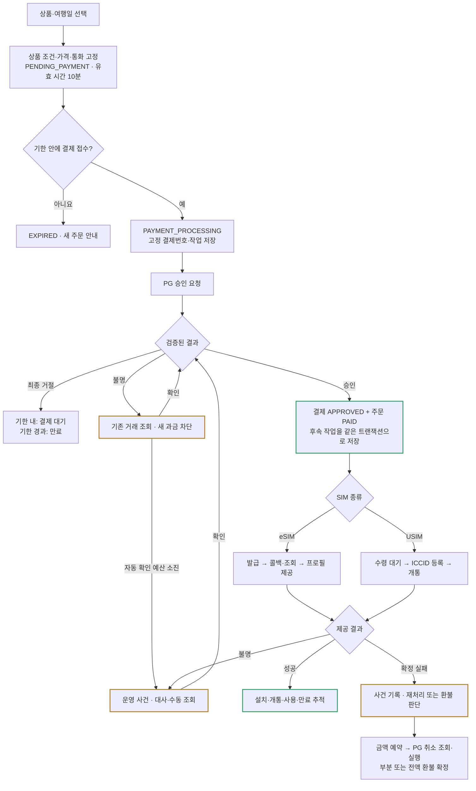
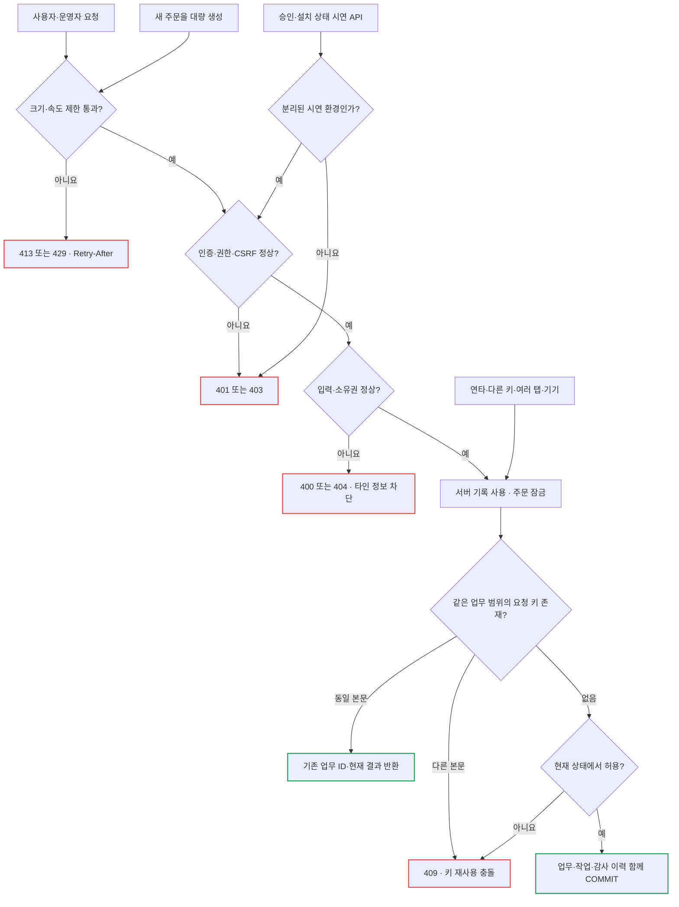
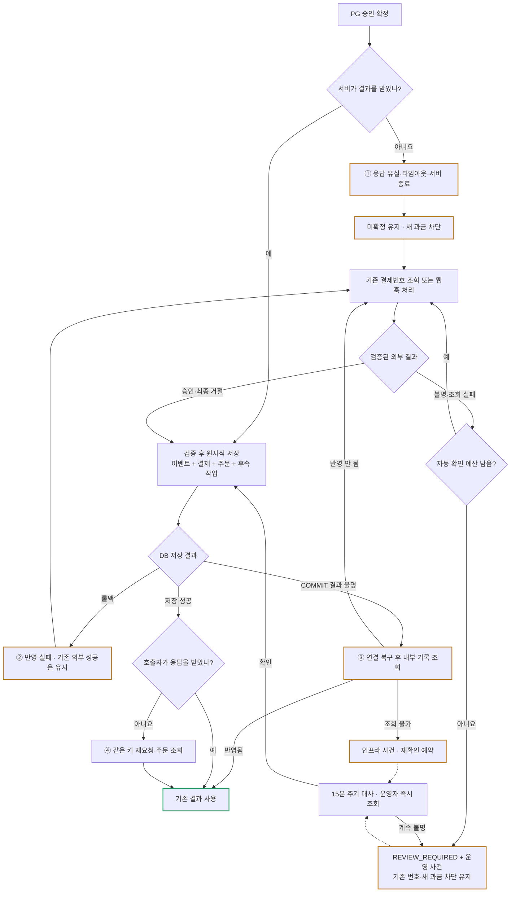
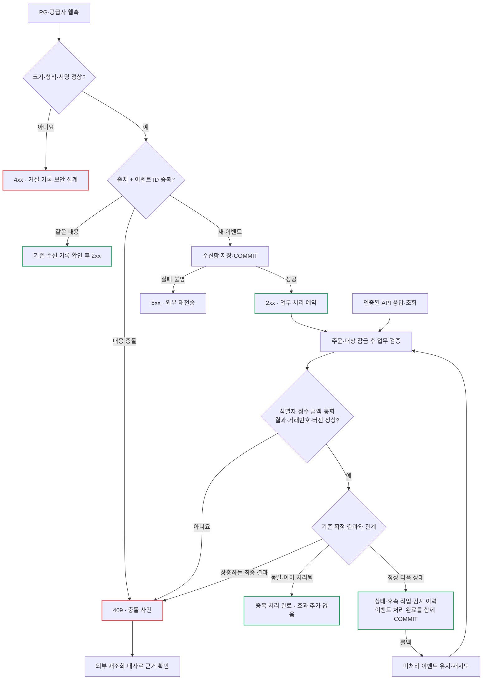
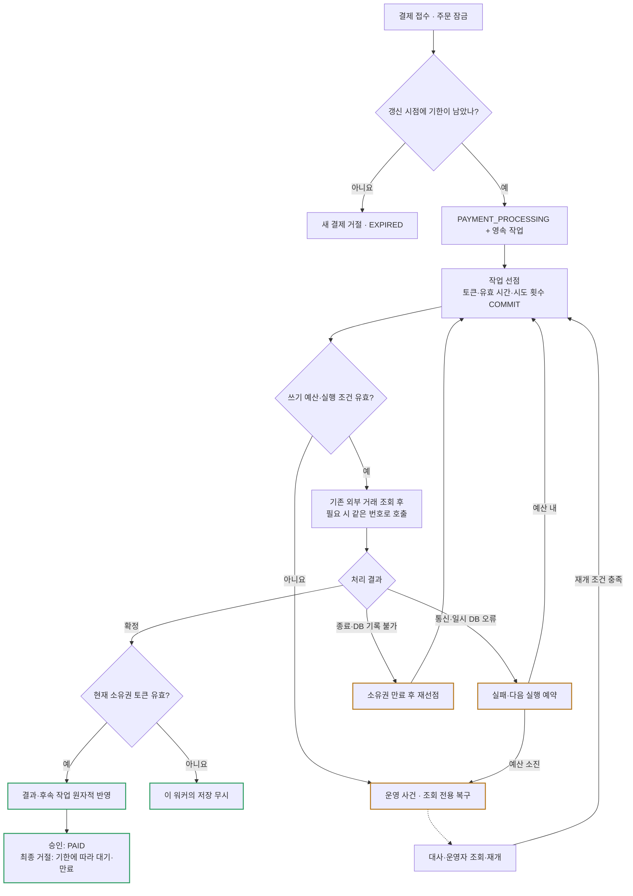
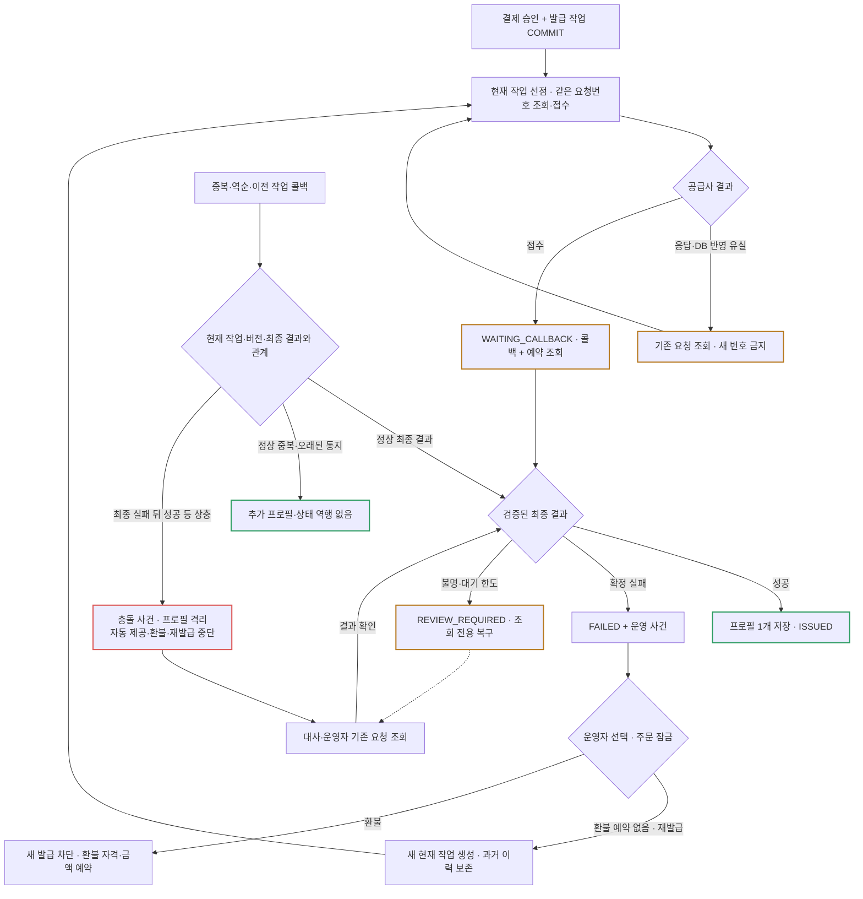
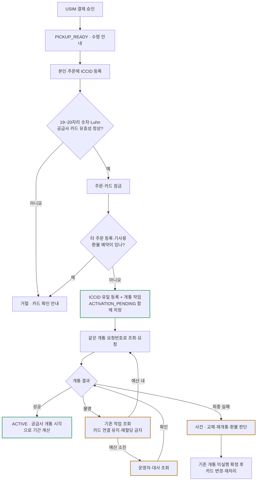
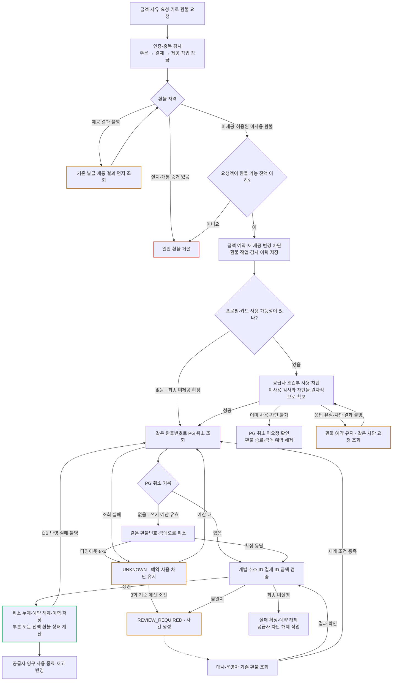
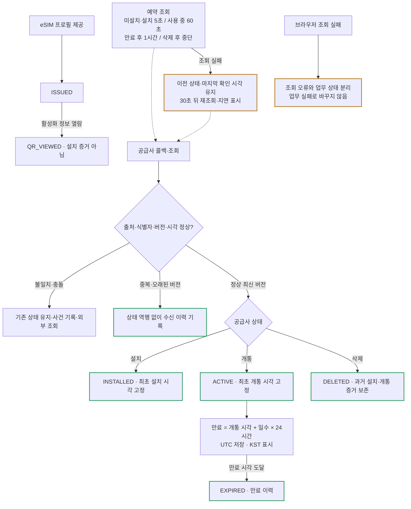
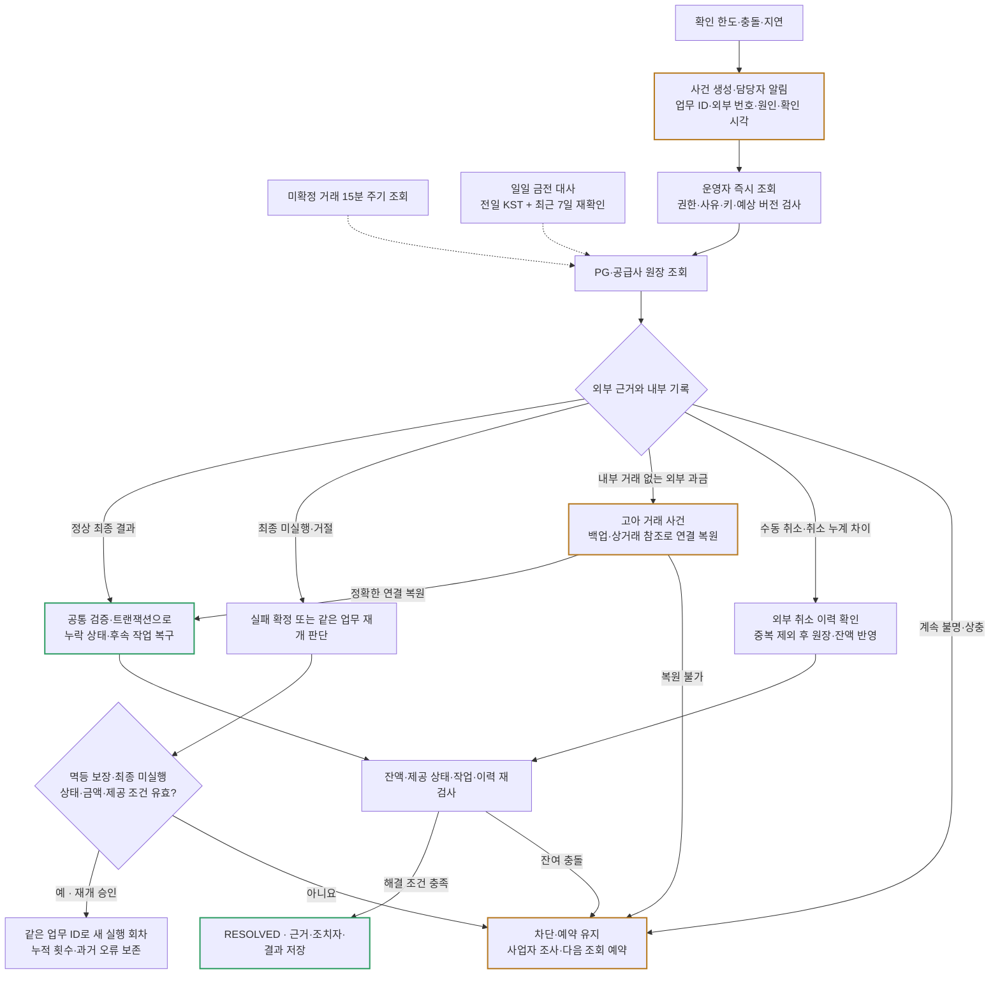

# 결제·발급·환불 시스템 전체 설계

작성일: 2026-10-22. 정상 처리, 조작·중복·유실, 복구, 대사와 운영자 조치를 포함한 목표 설계다. 아래 흐름은 설계 동작이며 전체가 현재 구현되거나 실행 검증됐다는 뜻은 아니다. 구현 현황은 마지막 절에 분리한다.

## 설계 원칙과 표기

- 주문, 결제 시도, 발급·개통 작업, SIM 프로필, 환불, 운영 사건을 별도 기록으로 관리한다. 결제 완료가 SIM 제공 완료를 뜻하지 않는다.
- 외부 PG·공급사와 우리 DB는 별도 트랜잭션이다. 내부 롤백으로 외부 승인·발급·취소가 되돌아가지는 않는다.
- 무응답은 실패의 증거가 아니다. 결과 불명 상태에서는 기존 업무 번호로 조회하며 새 과금·중복 발급·중복 환불을 차단한다.
- 외부 호출은 여러 번 일어날 수 있다. 고정 요청번호, 외부 멱등 처리, 내부 유니크 제약과 상태 검사로 업무 효과를 한 번만 반영한다.
- 실선은 처리·상태 전이, 점선은 비동기 전달·예약 조회·감시다. 점선은 구현 여부를 뜻하지 않는다. 초록은 정상 확정, 주황은 확인 중, 빨강은 거절·충돌·운영 사건이다.
- 시간·횟수·요청 제한은 설계 초기값이다. 사업자의 조회 지연·멱등 보장 기간과 운영 부하를 확인해 설정하며 적용값과 변경 시점을 기록한다.

## 목차

1. [전체 흐름과 상태](#1-전체-흐름과-상태)
2. [요청 검증과 중복 방어](#2-요청-검증과-중복-방어)
3. [PG 승인 후 유실과 DB 반영 실패](#3-pg-승인-후-유실과-db-반영-실패)
4. [응답·웹훅의 영속 수신](#4-응답웹훅의-영속-수신)
5. [만료·워커·재시도](#5-만료워커재시도)
6. [eSIM 발급과 재발급](#6-esim-발급과-재발급)
7. [USIM 수령과 개통](#7-usim-수령과-개통)
8. [전액·부분 환불과 설치 경합](#8-전액부분-환불과-설치-경합)
9. [설치·사용·만료 신호](#9-설치사용만료-신호)
10. [대사와 운영자 복구](#10-대사와-운영자-복구)
11. [데이터·트랜잭션·API 계약](#11-데이터트랜잭션api-계약)
12. [검증과 구현 현황](#12-검증과-구현-현황)

## 1. 전체 흐름과 상태

HTTP 202는 작업 접수 완료다. 결제와 후속 발급·개통은 서버에서 진행하고 브라우저 종료·로그아웃과 독립적으로 끝낸다.

### 상태와 허용 전이

- 주문: `PENDING_PAYMENT → PAYMENT_PROCESSING → PAID`. 최종 거절은 기한이 남으면 `PENDING_PAYMENT`, 지났으면 `EXPIRED`다. 접수 후 기한 경과만으로 미확정 결제를 만료시키지 않는다.
- 결제 시도: `QUEUED → PROCESSING → APPROVED / DECLINED / UNKNOWN`. 자동 실행 예산 소진 시 `REVIEW_REQUIRED`. `UNKNOWN / REVIEW_REQUIRED → APPROVED / DECLINED`는 검증된 외부 근거로 허용한다.
- eSIM 발급: `QUEUED → PROCESSING → WAITING_CALLBACK → ISSUED / FAILED`. 불명 결과는 조회하고 예산 소진 시 `REVIEW_REQUIRED`로 간다. 검증된 최종 결과로 미확정 상태를 종료한다.
- USIM 제공: `PICKUP_READY → ACTIVATION_PENDING → ACTIVE`. 개통 작업의 불명·실패는 별도 작업 상태로 표시한다. 미확정 ICCID를 다른 주문으로 해제·재할당하지 않는다.
- 환불: `REQUESTED → PROCESSING → SUCCEEDED / FAILED / UNKNOWN / REVIEW_REQUIRED`. `FAILED`는 취소 미실행이 최종 확인된 경우에만 사용한다. 타임아웃은 실패 확정이 아니다.
- 주문 환불 표시는 미확정 환불이 있으면 `REFUND_PROCESSING`, 확정 취소 누계가 승인액보다 작고 0보다 크면 `PARTIALLY_REFUNDED`, 승인액과 같으면 `REFUNDED`다. 실패 종료 후에는 확정 누계에 맞게 금전 상태를 계산한다.
- 상충하는 최종 결과는 운영 사건으로 격리한다. 운영자가 화면 상태를 임의로 덮어쓰지 않는다. PG의 승인 후 취소는 승인 자체를 삭제하지 않고 별도 취소 이력으로 반영한다.

## 2. 요청 검증과 중복 방어

가격·통화·상품 조건은 주문 생성 시 DB에서 읽어 고정한다. 회원 ID는 로그인 세션에서 얻는다. 본문·헤더의 가격·사용자 ID를 업무 판단의 근거로 쓰지 않는다.

### 요청 계약

- 주문 키는 `(회원, 요청 키)`, 결제 키와 운영자 조치 키는 `(주문, 요청 키)` 범위에서 유일하다. 정규화한 본문 해시를 함께 저장한다. 같은 키·다른 조건은 409다.
- 요청 키는 연결된 거래 기록과 함께 보존한다. 단기 캐시 만료로 중복 방어가 사라지지 않게 한다. 브라우저는 접수 결과를 알 때까지 키·본문을 유지하며, 키를 잃으면 기존 주문부터 조회한다.
- 주문당 최종 거절을 제외한 활성 결제는 하나다. 다른 키도 우회할 수 없다. 최종 거절이 확정되고 기한이 남았을 때만 새 결제를 만든다.
- 운영자 조치는 실행자·사유·대상 업무 버전을 검사한다. 다른 운영자가 재전송하더라도 최초 실행자 기록은 바꾸지 않는다.
- 외부 API는 서버 전용 인증을 사용한다. Gateway 내부 인증, 사용자 세션, 업무 소유권은 별도로 확인한다. 운영 환경에서는 승인 결과·공급사 상태를 선택하는 시연 API를 열지 않는다.
- JSON 본문은 16 KiB로 프록시·애플리케이션의 읽기 단계부터 제한한다. 파싱 후 길이 검사만으로 대용량 요청을 방어하지 않는다.
- 업무 변경은 회원별 분당 30회·IP별 분당 300회, 로그인은 계정별 분당 5회·IP별 분당 30회를 초기값으로 둔다. 웹훅과 읽기 요청은 별도 한도를 적용하고 공유 IP·정상 재전송을 부하 테스트로 확인한다. 429에는 Retry-After를 제공한다.

## 3. PG 승인 후 유실과 DB 반영 실패

승인 전에 결제 시도·고정 외부 요청번호를 저장한다. PG 어댑터는 같은 요청번호의 멱등 승인과 거래 조회 계약을 제공한다. 내부 DB와 외부 PG의 성공 여부를 각각 확인한다.

조회 404는 최종 거절이 아니다. 조회 반영 지연이나 먼저 보낸 요청의 진행 중 상태일 수 있다. 멱등 보장 기간 안에서 같은 결제번호로만 승인 재전송한다. 보장 기간이 지났거나 동일 번호의 중복 방어가 보장되지 않으면 재승인 없이 조회·대사·사업자 조사로 확인한다.

`REVIEW_REQUIRED`는 실패나 주문 종료가 아니다. 자동 쓰기를 멈춘 상태이며 검증된 조회·웹훅으로 최종 결과를 반영한다. 운영자는 근거 없이 거절로 바꾸거나 새 결제를 허용하지 않는다.

## 4. 응답·웹훅의 영속 수신

웹훅은 영속 수신함(inbox)에 저장한 뒤 2xx로 응답한다. 저장 실패·COMMIT 결과 불명에는 2xx를 보내지 않는다. 업무 처리는 워커가 수행한다. API 응답·조회 결과도 같은 검증·반영 경로로 연결한다.

- 같은 이벤트 ID의 본문 충돌은 최종 상태가 같아도 검사한다. 다른 이벤트 ID의 동일 업무 결과도 상태·외부 거래번호 제약으로 중복 반영을 막는다.
- 서명은 원본 바이트로 검사한다. 복구용 원문이 필요하면 암호화·접근 통제하고 감사 화면에는 식별자·해시·검증 결과만 제공한다. 활성화 코드는 권한을 확인해 별도로 제공하며 로그에 전체를 남기지 않는다.
- 늦은 정상 통지를 일괄 폐기하지 않고 버전·최종 상태로 판단한다. 타임스탬프 서명·재전송 기간은 사업자 계약에 맞추며 키 교체 시 key ID·검증 허용 기간을 기록한다.
- DB 장애로 거절 기록을 저장하지 못하면 민감 정보 없는 외부 로그·메트릭으로 알린다. DB 장애 중에도 감사 기록이 저장됐다고 가정하지 않는다.

## 5. 만료·워커·재시도

미결제 기한은 생성 후 10분이다. 잠금을 기다린 시간까지 포함해 실제 갱신 시점의 DB 시각으로 검사한다. 결제가 접수된 뒤에는 기한이 지나도 기존 결과 확인을 끝낸다.

### 실행 정책 초기값

- 외부 HTTP 타임아웃 2초, 작업 소유권 유효 시간 30초. 선점만 먼저 커밋하고 외부 호출 동안 DB 잠금을 잡지 않는다. 재선점은 새 토큰을 발급하고 결과 반영 시 현재 토큰·상태를 검사한다.
- 결제 자동 실행 예산 6회, 환불 3회. 선점 시 시도 횟수를 먼저 저장해 프로세스 종료·일반 런타임 오류도 예산에 포함한다. 소진 후 새 승인·취소 호출 없이 조회로 확인한다.
- 일시 실패 지연은 `min(30초, 1초 × 2^(시도 횟수 - 1))`에 최대 20% 임의 지연을 더한다. 인증 실패·형식 오류·내용 충돌은 쓰기 재시도 없이 사건으로 분류한다.
- 정상 `ACCEPTED` 발급은 5초 간격으로 최대 2분 조회한다. 통신 실패는 별도 연속 실패 예산 6회를 적용한다. 정상 대기 횟수를 통신 실패 횟수에 합치지 않는다.
- 수신함 일시 처리 오류도 6회 뒤 사건으로 전환하고 이벤트를 보류 상태로 보존한다. 이벤트 처리 완료와 상태·작업 변경은 함께 커밋한다.
- 선점 저장에 실패하면 외부 호출하지 않는다. DB 접속 장애의 재연결은 인프라 감시 대상이며 외부 쓰기 작업을 발생시키지 않는다.
- 재시작 시 미처리 수신함·만료된 소유권을 복구한다. 워커는 상시 실행하고 배포 중에도 작업이 DB에 남아 이어지게 한다. 새 실행 회차는 운영자 승인·근거를 남기며 누적 횟수는 초기화하지 않는다.

## 6. eSIM 발급과 재발급

최초 발급 작업은 승인 반영과 함께 저장한다. 접수 응답 유실은 같은 작업 번호로 조회한다. 최종 실패한 작업을 재발급할 때만 새 작업 ID를 만들고 과거 작업을 보존한다.

주문·발급 작업·공급사 주문번호·ICCID의 유니크 제약으로 프로필 중복을 막는다. 콜백·조회는 같은 검증 경로로 처리한다. 확정 실패는 해당 요청이 나중에 성공으로 바뀌지 않는 공급사 계약을 전제로 한다. 그 보장이 없으면 외부 취소·미발급 확정을 얻기 전에는 재발급·환불을 실행하지 않는다.

## 7. USIM 수령과 개통

결제 확정 후 `PICKUP_READY`로 표시한다. ICCID 등록은 카드 연결과 개통 작업 접수이며 개통 완료가 아니다.

ICCID는 전체 주문에서 유일하게 연결한다. 형식 외에도 공급사 카드 존재·상품 호환·기사용 여부를 확인한다. 개통은 결제와 동일하게 자동 실행 6회 예산과 조회 복구를 적용한다. USIM은 eSIM의 QR 열람·설치 단계 없이 공급사의 개통 신호로 사용 시작을 판단한다.

## 8. 전액·부분 환불과 설치 경합

결제당 여러 부분 환불을 허용하되 각 환불은 고정 환불번호를 사용한다. 접수·금액 예약·공급사 사용 차단·PG 취소·최종 반영을 분리한다. 타임아웃만으로 예약을 해제하지 않는다.

이 설계의 부분 환불은 미제공·미사용 주문의 제공 종료에 따른 금액 반환이다. 수수료 차감 등으로 일부만 돌려주더라도 해당 SIM의 제공은 종료하며, 이미 설치·개통된 SIM의 사용량 비례 환불은 일반 환불 정책에 포함하지 않는다. 추가 금액 반환은 같은 승인 잔액 안에서 별도 환불로 기록한다.

### 금액·예약·동시성 규칙

- 환불 가능 잔액은 `승인 금액 - 확정 취소 누계 - 미확정 환불 예약액 합계`다. 요청액은 0보다 크고 잔액 이하다. 정수 금액·통화 코드로 저장한다.
- 결제 행을 잠근 상태에서 누계·예약을 계산한다. 다른 키·다른 운영자의 동시 환불도 모든 미확정 예약을 포함한다. 동일 키·동일 본문은 기존 환불을 반환한다.
- PG 결과는 개별 환불번호·금액으로 검증한다. 누적 취소액은 다른 부분 취소와 경합할 수 있으므로 단일 환불액과 같아야 한다고 가정하지 않는다. 누계 차이는 대사로 확인한다.
- 불명 취소 재개는 기존 환불번호·금액을 유지한다. 최종 미실행으로 종료된 환불을 다른 조건으로 다시 신청할 때만 새 환불을 만든다.
- 환불 예약과 재발급·카드 교체는 같은 주문 잠금으로 상호 배제한다. 이미 외부에서 진행 중인 제공은 로컬 잠금만으로 멈췄다고 가정하지 않는다.
- 외부 수동 취소가 발견되면 확인된 취소를 중복 없이 반영하고 남은 예약을 다시 검사한다. 초과 가능성이 생긴 기존 요청은 추가 취소 없이 조사한다.

### 설치·개통과 환불의 경합 계약

발급 후 미사용 환불은 공급사가 미사용 상태 검사와 이후 설치·개통 차단을 원자적으로 수행하는 상품에만 허용한다. 차단은 PG 취소가 확정될 때까지 유지하고 결과 불명 중 자동 만료되지 않아야 한다. 차단 요청의 응답이 유실되면 같은 요청을 조회하며 PG 취소로 넘어가지 않는다.

취소 성공 시 공급사의 영구 사용 종료를 영속 작업으로 마무리한다. 취소 미실행이 최종 확정되면 사용 차단 해제도 영속 작업으로 실행한다. 외부 차단의 TTL만으로 미확정 환불 중 사용이 다시 열리지 않도록 공급사 계약을 확인한다.

사용 차단 자체가 끝내 불명확하면 자동 실행 6회 뒤 운영 사건으로 전환하고 금액 예약을 유지한 채 조회·사업자 조사로 확인한다. 차단 해제·영구 사용 종료 작업도 회차별 6회 예산을 적용하며, 소진 시 사건을 남기고 대사·운영자 재개로 마무리한다. 금전 환불 완료와 공급사 정리 완료를 별도로 표시한다.

이 계약이 없는 상품은 발급 실패·미제공 환불만 허용한다. 최신 조회만으로 발급 후 환불을 허용하지 않는다. 조회 직후 실제 설치가 시작되는 경합은 로컬 DB 잠금으로 막을 수 없다. 설치·개통된 SIM은 일반 환불을 거절하며 예외 금전 보상은 별도 운영 승인·사유·외부 근거로 관리한다.

## 9. 설치·사용·만료 신호

최초 확정한 설치·개통 시각을 보존하며 변경 시각·상태 역행은 사건으로 처리한다. 외부 발생 시각과 우리 수신 시각을 모두 남긴다. 서버 시각을 동기화하고 미래 5초를 넘는 신호는 보류·재조회한다. 단계가 건너뛰어도 설치·개통 근거가 함께 유효하면 반영한다.

삭제로 과거 설치 증거를 지우지 않는다. 만료는 콜백 없이 계산하고 워커가 멈춰 있어도 조회 응답에서 유효 만료 상태를 계산한다. 화면에는 업무 상태·마지막 공급사 확인 시각·조회 오류·사용자가 할 수 있는 행동을 분리해 보여준다.

## 10. 대사와 운영자 복구

자동 쓰기 중단 뒤에도 기존 거래는 조회·대사 대상이다. 운영자는 상태를 수동 입력하는 대신 외부 근거를 조회하고 기존 업무 번호로 복구한다.

### 대사·감시·사건 정책

- 15분 주기 대상은 미확정 거래·장기 처리 중·제공 지연·불명 환불·취소 누계 충돌이다. 장기 미해결 사건은 나이와 관계없이 남긴다. 대사 자체는 새 승인·취소를 만들지 않는다.
- 일일 금전 대사는 전일 KST와 최근 7일을 중첩 조회한다. 외부 사후 변경은 이벤트·일일 대사로 수집하고 장애·복원 조사 때는 해당 기간 전체를 다시 확인한다. 조회 구간·페이지·커서·마지막 성공 시점을 저장한다.
- 사건은 `(업무, 원인, 미해결 상태)`로 중복을 합치고 `OPEN → INVESTIGATING → RESOLVED`로 관리한다. 재발은 새 근거와 함께 다시 연다.
- 워커 heartbeat 60초 초과 누락, 실행 가능한 작업의 최장 대기 2분 초과, 공급사 확인 실패 5분 초과에 알린다. 금액·식별자 충돌과 고아 과금은 즉시 알린다. 변경 없는 상태의 반복 통지 대신 악화·복구·담당자 조치에 맞춰 갱신한다.
- 운영자 재개는 대상 버전을 검사하고 같은 업무 ID로 새 실행 회차를 예약한다. 두 운영자가 동시에 재개해도 활성 회차는 하나다. 조회로 결과가 확정되면 재개 없이 공통 반영 경로로 종료한다.
- DB 복원 후에는 새 쓰기 작업을 열기 전에 장애 구간의 외부 승인·취소·제공 기록을 대사한다. 고아 거래의 소유자·상품·금액을 복원하기 전에는 자동 제공·새 과금·임의 환불을 하지 않는다.
- 키 교체는 key ID·검증 허용 기간을 기록한다. 잘못된 서명은 보안 집계, 서명은 맞지만 거래 내용이 틀린 경우는 거래 충돌로 분류한다.
- 사건 종료에는 외부 결과 확인, 내부 상태·잔액·예약 정합성, 후속 작업 존재, 감사 기록 저장이 모두 필요하다. 단순히 목록에서 숨기는 조치는 종료가 아니다.

## 11. 데이터·트랜잭션·API 계약

### 주요 기록과 유일성

- `orders`: 회원·요청 키, 가격·통화·상품 조건 스냅샷, 상태·버전, 생성·만료 시각.
- `payment_attempts`: 주문·요청 키, 고정 PG 요청번호, 금액·통화·결과·PG 거래번호. 최종 거절 외 활성 결제는 주문당 하나다.
- `inbound_events`: 출처·이벤트 ID 유일성, 본문 해시, 보호된 처리 자료, 검증·처리 상태·오류·다음 시각.
- `jobs / execution_rounds`: 업무 종류·참조별 활성 작업 유일성, 누적 시도·회차별 예산, 토큰·유효 시간·다음 실행 시각. 업무 변경과 같은 트랜잭션으로 기록하는 작업이 outbox 역할을 한다.
- `fulfillment_jobs / sim_profiles / usim_bindings`: 현재 제공 작업, 공급사 요청번호, 주문당 프로필·전역 ICCID 유일성, 설치·개통 증거·버전·사용 차단 상태.
- `refunds`: 결제 ID, 고정 환불번호·요청 키, 요청액·예약액·상태·PG 취소 ID. 결제당 여러 환불을 허용하고 PG 취소 ID는 유일하다.
- `external_cancellations`: 외부 취소 ID·금액·시각과 원 결제 연결. 외부 수동 취소도 수집하며 내부 환불과 중복 합산하지 않는다.
- `incidents / admin_actions / status_history`: 담당자·근거, 실행자·사유·요청 키, 이전·다음 상태, 외부 발생·수신·내부 반영 시각. 일반 애플리케이션 권한으로 과거 이력을 수정·삭제하지 않는다.

### 트랜잭션 경계

1. 접수: 소유권·상태·요청 키를 확인하고 업무 상태·작업·감사 이력을 함께 커밋한다.
2. 선점: 소유권·시도 횟수만 짧게 커밋한다. 외부 호출은 트랜잭션 밖이다.
3. 반영: 필요한 행을 주문 → 결제 → 제공 작업·프로필 → 환불 순서로 잠그고 상태·잔액·후속 작업·수신 이벤트 처리 완료·이력을 함께 커밋한다. 워커는 토큰, 콜백·대사는 상태·버전으로 경합을 제어한다.
4. 환불 예약: 결제 잠금 아래 확정액·예약액을 계산해 예약한다. 무응답만으로 예약을 해제하지 않는다.
5. COMMIT 결과 불명은 기존 ID 재조회로 확인한다. 외부 성공과 내부 저장을 하나의 트랜잭션으로 취급하지 않는다.

### API 설계

- 주문·결제: `POST /api/orders`, `POST /api/orders/{id}/payment-attempts`, 주문·결제 시도의 조회 API.
- SIM: `GET /api/sims/{id}/tracking`, `POST /api/sims/{id}/activation-view`, `POST /api/orders/{id}/usim-registrations`. 카드 등록은 개통 작업 ID를 반환한다.
- 운영자 조치: `POST /api/admin/orders/{id}/issuance-retries`, `POST /api/admin/orders/{id}/refunds`. 환불은 요청액·사유를 명시한다.
- 재조회: `POST /api/admin/orders/{id}/reconciliations`. 업무 종류·ID·예상 버전·사유·요청 키를 받아 외부 조회를 예약한다. 접수만으로 승인·환불 성공을 선언하지 않는다.
- 재개: `POST /api/admin/orders/{id}/recoveries`. 외부 근거·버전·사유를 검사해 같은 업무 ID의 새 실행 회차를 만든다. 불명 거래를 새 과금·발급 번호로 바꾸지 않는다.
- 사건: `GET /api/admin/incidents`, `GET /api/admin/incidents/{id}`. 연결된 업무·외부 신호·조사·조치를 제공한다.
- 수신: `/webhooks/pg`, `/webhooks/supplier`, `/webhooks/supplier/profiles`. 취소 웹훅이 있으면 동일 영속 수신 경로로 연결하고, 없으면 조회로 종료한다.
- 변경 요청은 요청 키를 받으며 최초 비동기 접수 202, 같은 접수 재현 200, 조건 충돌 409다. 502·504·네트워크 오류는 업무 미실행을 의미하지 않는다.
- 조회는 업무·작업 상태, 마지막 확인 시각·공급사 동기화 시각, 사건 참조·허용 행동을 제공한다. 결과 확인 중에는 기존 주문 조회를 안내하고 재결제를 유도하지 않는다.

## 12. 검증과 구현 현황

### 설계 수용 조건

1. 같은 키 20개·다른 키 20개 동시 결제에서 활성 결제·PG 승인 효과가 하나만 남는다. 위조 가격·소유자·서명·이벤트 내용은 금액·상태를 바꾸지 못한다.
2. PG 요청·응답 유실, DB 롤백·COMMIT 결과 불명, 브라우저 종료·재시작에서 같은 거래번호로 복구한다. 결과 불명 중 새 과금이 없다.
3. 응답·웹훅·대사의 경합에서 결제·후속 작업은 하나다. 수신함 저장 뒤 프로세스를 종료해도 처리하며 이벤트 완료와 상태 변경은 함께 롤백된다.
4. 늦은 워커는 결과를 덮어쓰지 못한다. 일반 DB·런타임 오류도 회차 예산에 포함되며 소진 뒤 새 외부 쓰기가 없다.
5. 발급 접수 유실·콜백 중복·누락·역순·과거 작업 콜백에서 프로필은 하나다. 불명 발급과 환불·새 발급이 동시에 실행되지 않는다.
6. 잘못된 ICCID·중복 등록을 거절한다. 개통 불명 중 카드·요청번호를 유지하고 타 주문에 재할당하지 않는다.
7. 동시 부분 환불의 확정액+예약액은 승인액을 넘지 않는다. 수동 취소·응답 유실·DB 완료 실패에서도 취소를 중복 계산·실행하지 않는다.
8. 공급사 사용 차단과 설치·개통이 경합할 때 허용된 한쪽만 확정된다. 불명 차단·취소 동안 예약을 유지하며 차단 계약이 없는 상품은 발급 후 일반 환불을 접수하지 않는다.
9. 운영자 재개·동시 조치·오래된 화면에도 기존 업무 ID·사유·최초 실행자를 보존하고 활성 실행 회차는 하나다.
10. DB 복원·고아 과금·장기 불일치를 대사가 찾고 근거로 복구한다. 종료 조건을 만족하지 못한 사건은 해결 처리되지 않는다.
11. 삭제·신호 누락·UTC/KST 경계에서도 설치 증거·24시간 단위 만료를 유지한다. 화면 조회 실패는 업무 실패가 아니다.
12. 요청 폭주·키 교체·워커 중단·작업 적체를 검증한다. 독립된 외부 테스트 환경에서 멱등 보장 기간·조회 지연·사용 차단 계약을 확인한다.

### 구현 현황과 설계의 구분

저장소에는 eSIM 주문·결제, DB 작업 선점, 모의 PG·공급사, 콜백 검증·조회, 발급 실패 후 운영자 재발급·전액 환불, 설치 추적·감사 이력이 있다. 이는 설계의 출발점이다. 위의 전체 상태·API·영속 수신함·실행 회차·USIM·부분 환불·사용 차단·대사·감시 계약이 모두 같은 방식으로 구현됐다는 뜻은 아니다.

### 1단계 구현: 재시도 한도와 결과 충돌 차단

- 결제 6회·환불 3회의 실행 예산을 호출 전에 DB에 예약한다. DB 결과 반영과 오류 기록이 모두 실패해도 lease 복구 시 저장된 예산부터 검사한다. 소진된 회차는 외부 호출 없이 확인 필요 상태로 전환한다.
- 발급은 정상 대기와 연속 실패를 구분한다. 정상 응답을 저장하면 연속 실패 횟수를 초기화하며, 최초 접수 확인부터 2분이 지나거나 연속 실패 6회면 자동 확인을 중단한다. 정상 조회와 별도로 공급사 접수 호출도 최대 6회다. 기본 조회 간격은 5초다.
- 누적 확인 횟수와 실행 회차를 보존한다. 현재는 최초 회차만 있으며 새 실행 회차를 여는 운영자 복구 API는 3단계 대상이다. 서버 재시작만으로 예산을 초기화하지 않는다.
- 인증된 외부 결과의 식별자·금액·최종 상태·이벤트 내용 충돌은 `order_conflicts`와 감사 이력에 저장한다. 실제 결제·발급 ID에 연결된 주문을 격리하고 새 결제·재발급·환불·활성화 정보 제공을 차단한다. 외부 조회 후 승인·취소를 보내기 직전에도 충돌을 다시 확인한다. 다만 마지막 DB 검사와 외부 HTTP 호출은 원자적이지 않으므로 그 사이에 발생한 충돌이나 이미 전송된 요청을 소급 취소할 수는 없다. 이런 경우에도 충돌 주문의 내부 결과 반영은 차단한다.
- 동일 충돌의 반복 통지는 같은 사건으로 합친다. 운영자 상세와 확인 필요 목록에 나타나며 일반 앱 DB 계정은 충돌 기록을 수정·삭제할 수 없다. 이후 정상 통지가 오더라도 격리를 자동 해제하지 않는다.
- 이 단계는 영속 수신함이나 운영자 재조회·재개 기능을 포함하지 않는다. 충돌 격리 해제는 외부 근거를 검증하는 후속 복구 단계에서 구현한다.

구현 참고:

- [주문·기한 검사](../backend/service/src/service/OrderRepository.java), [결제 접수](../backend/service/src/service/PaymentService.java), [결제 워커](../backend/service/src/service/PaymentWorker.java), [결제 결과 반영](../backend/service/src/service/PaymentTransitions.java).
- [PG 클라이언트](../backend/service/src/service/PgClient.java), [PG 웹훅](../backend/service/src/service/PgWebhookController.java), [결제 제약](../backend/database/migration/V4__payments_and_mock_pg.sql).
- [발급 워커](../backend/service/src/service/IssuanceWorker.java), [발급 반영](../backend/service/src/service/IssuanceService.java), [공급사 콜백](../backend/service/src/service/SupplierWebhookController.java).
- [운영자 조치](../backend/service/src/service/AdminActionService.java), [환불 워커](../backend/service/src/service/RefundWorker.java), [환불 반영](../backend/service/src/service/RefundService.java).
- [설치 반영](../backend/service/src/service/ProfileTrackingService.java), [SIM 생명주기](sim-lifecycle.md), [데이터 계약](data-contract.md), [기존 통합 테스트](../tests/orders.integration.test.mjs).

위 설계 수용 조건 전체의 구현·검증 완료를 의미하지 않는다. 1단계의 재시도·충돌 검증은 통합 테스트의 `retry policy`, `conflict policy` 시나리오에 포함한다.
