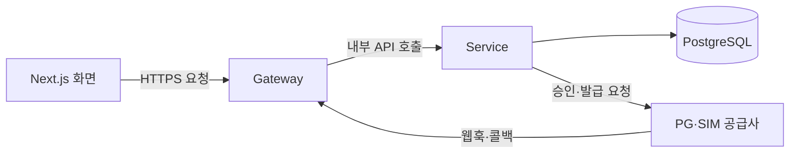
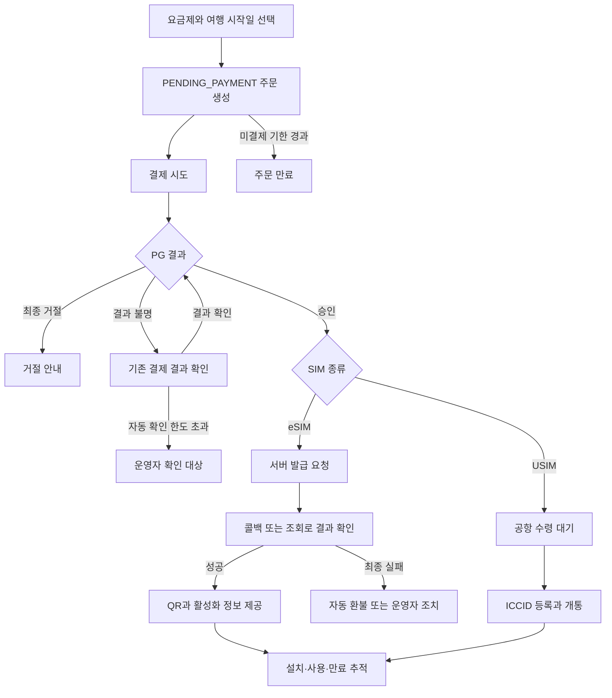

# Alpha Media 여행용 SIM 서비스 기획서

여행자가 목적지와 일정에 맞는 eSIM 또는 USIM을 구매하고, 결제부터 발급·개통·사용 상태 확인까지 이용하는 서비스다. 고객이 여행 전에 SIM을 준비할 수 있도록 처리 상황과 필요한 행동을 안내하고, 운영자는 지연·실패한 주문을 찾아 복구한다.


## 1. 서비스 목표와 사용자

고객은 자신의 여행 조건에 맞는 상품을 고르고, 결제 후 SIM이 준비되는 과정을 이해할 수 있어야 한다. 브라우저를 닫았다가 돌아와도 주문과 처리 결과를 확인할 수 있어야 한다.

운영자는 결제됐지만 발급되지 않은 주문, 반복해서 환불에 실패한 주문 등을 발견하고, 이전 처리 내역을 확인한 뒤 필요한 조치를 수행할 수 있어야 한다.

| 사용자 | 주요 목적 |
|---|---|
| 고객 | 요금제 구매, eSIM 설치 정보 확인, USIM 등록, 사용 상태와 환불 가능 여부 확인 |
| 운영자 | 주문 검색, 결제·발급·설치 이력 확인, 이상 건 확인, 수동 환불과 발급 재시도 |

고객은 본인 확인을 거쳐 자신의 주문과 SIM에 접근한다. 운영자 기능에는 별도의 권한을 적용하고, 발급 재시도·환불 등 주요 조치에 실행자와 사유를 남긴다. 로그인·주문 조회의 구체적인 인증 방식은 접근 정책에서 정한다.

## 2. 서비스 기술 선택

**Next.js, Spring Boot, PostgreSQL**을 중심으로 구성한다. 고객 화면의 개발·유지보수, 결제와 발급의 데이터 정합성, 외부 연동 장애에서의 복구 가능성을 기술 선택 기준으로 삼는다. 호스팅과 세부 라이브러리의 선택안은 운영 비용과 검증 결과를 확인한 뒤 확정한다.

### 전체 구조와 폴더 역할

```text
frontend/          고객·운영자 화면
backend/
  gateway/         외부 요청 진입점과 라우팅
  service/         API·업무 규칙·DB 접근·백그라운드 작업
  database/        DB 스키마 변경 SQL·인덱스·요금제 시드
```

`gateway`와 `service`는 각각 실행·배포하는 Spring 애플리케이션이다. `database`는 DB 구성 파일을 관리하는 폴더이며, 실제 데이터는 별도의 PostgreSQL 인스턴스에 저장한다. DB 조회·저장 코드는 `service`의 Repository에 둔다.



### 프론트엔드

**Next.js App Router, TypeScript, Tailwind CSS, ESLint**를 사용한다. 현재 생성된 기본 프로젝트 구성을 활용해 고객과 운영자 화면을 한 프로젝트에서 관리한다.

초기 데이터 조회와 화면 표시, 결제 버튼·ICCID 입력·상태 갱신의 역할을 구분한다. 결제 승인 여부, 환불 가능 여부, 주문 금액의 최종 판단은 `service`가 수행한다. 화면은 서버가 반환한 상태를 표시하며, 화면을 닫아도 주문 처리가 이어지도록 후속 발급을 브라우저에 맡기지 않는다.

결제·발급·환불 상태에는 마지막 확인 시각을 표시하고 다시 조회할 수 있게 한다. 자동 갱신 주기와 오래된 데이터의 표시 기준은 7번 정책에서 정한다.

### Gateway

**Spring Cloud Gateway의 Web MVC 방식**을 선택안으로 둔다. Spring 기반으로 요청 경로와 공통 필터를 관리하며, Service와 같은 Java·Spring 개발 방식을 사용할 수 있다. [공식 문서](https://docs.spring.io/spring-cloud-gateway/reference/spring-cloud-gateway-server-webmvc.html)

Gateway는 고객·운영자 API와 외부 콜백의 진입점이다. 허용 경로, 요청 크기, 요청 추적 ID 등 공통 처리를 담당하고 Service로 전달한다. 주문·결제의 업무 규칙과 DB 접근은 Service에 둔다. 사용자 식별 정보를 전달받아도 최종 주문 소유권과 운영자 권한은 Service에서 검사한다.

결제·발급·환불 POST 요청을 Gateway에서 무조건 자동 재전송하지 않는다. 재시도가 필요한 업무는 Service가 기존 업무 참조와 멱등키를 유지하며 통제한다.

Gateway 분리는 외부 진입 정책과 업무 처리를 분리하는 장점이 있지만, 배포와 운영 대상이 하나 늘어난다. 현재처럼 업무 Service가 하나인 규모에서는 필수 구성은 아니며, 분리 이유와 추가 비용을 함께 기록한다.

### Service

**Java 21, Spring Boot, Spring Web MVC**를 기본으로 사용한다. Controller는 요청·응답을 처리하고, 업무 Service는 주문·결제·발급·환불 정책을 수행하며, Repository는 DB 접근을 담당한다.

DB 접근은 **Spring JDBC의 JdbcTemplate**을 선택안으로 둔다. 결제·발급의 조건부 상태 변경과 잠금, 중복 방지 SQL, 트랜잭션 범위를 명시적으로 관리하기 위해서다. 연결·문장 실행 등 반복적인 JDBC 처리는 프레임워크에 맡긴다. [Spring JDBC 공식 문서](https://docs.spring.io/spring-framework/reference/data-access/jdbc/core.html)

PG·공급사 호출은 별도 Client 코드로 모은다. DB 변경 트랜잭션과 외부 HTTP 호출을 분리하고, 응답 유실 시 기존 참조로 확인하는 경로를 마련한다.

외부 연동은 PG·SIM 공급사의 승인·취소·발급·상태 조회 API와 콜백을 기준으로 설계한다. 실제 사업자는 지원 국가·상품, 응답 지연, 장애 시 결과 조회 수단, 취소 가능 범위와 비용을 비교해 선정한다. 개발 단계에서는 같은 연동 인터페이스를 구현한 모의 시스템으로 장애와 복구 흐름을 검증한다.

### 데이터베이스

**PostgreSQL**을 선택안으로 둔다. 주문·결제·환불·상태 이력의 관계를 표현하고, 함께 변경해야 하는 기록의 정합성을 관리하기에 적합하다. 여러 기록을 함께 저장하거나 함께 취소할 때 트랜잭션을 사용하고, 유니크 제약과 외래 키로 중복·잘못된 연결을 방어한다. 상품의 유연한 속성보다 금전 거래의 일관성이 중요한 현재 서비스에서는 관계형 DB를 우선한다. [트랜잭션](https://www.postgresql.org/docs/current/tutorial-transactions.html), [제약 조건](https://www.postgresql.org/docs/current/ddl-constraints.html)

금액은 정수 단위와 통화 코드를 함께 저장하고, 시각은 UTC 기준으로 보관해 화면에서 KST로 변환한다. 주문 시점의 상품 조건과 가격을 보관하는 방식은 주문 정책과 테이블 설계에서 구체화한다.

DB 스키마 변경은 **Flyway**로 순서와 적용 이력을 관리한다. `backend/database`의 SQL·시드가 Service 배포에 포함되도록 빌드를 구성하고, 배포 환경의 DB에 연결할 수 있는 시작 준비 단계에서 적용한다. 이미 적용한 SQL을 덮어쓰기보다 새 변경 파일을 추가한다.

DB 호스팅은 운영 부담을 줄일 수 있는 **관리형 PostgreSQL**을 사용하고, Neon을 우선 검토 후보로 둔다. 개발·검증에서는 무료 범위를 우선 활용한다. 운영 환경은 허용 지연, 연결 수, 백업·복구 요구, Railway와의 연결 및 월 예산을 확인한 뒤 서비스와 요금제를 확정한다. 외부 DB 연결에는 TLS를 사용하고 접속 정보는 Service 환경변수로 관리한다. [Neon 요금제](https://neon.com/docs/introduction/plans)

### 백그라운드 처리

초기에는 **DB에 저장한 작업과 Spring 스케줄러·워커**를 사용한다. 주문 만료, 발급 요청, 누락된 결과 조회, 환불 재시도를 서버가 수행하도록 한다.

업무 상태와 다음에 실행할 작업을 함께 저장하고, 실행할 작업을 선점한 뒤 외부 시스템을 호출한다. 작업 종류·업무 참조의 중복 제약과 실행 소유권 검사로 여러 워커가 같은 업무를 처리하는 상황을 방어한다.

서버가 종료되거나 수면 상태이면 작업 실행은 멈춘다. 재시작 시 DB에 남은 작업과 기한을 다시 확인해 재개한다. 운영 환경은 결제 확인·발급·환불 작업이 계속 실행될 수 있도록 가동 조건을 확보하고, 작업 적체와 마지막 실행 시각을 감시한다. 작업을 메모리에만 두지 않으며, 자동 처리 한도를 넘긴 건은 운영자가 확인할 수 있게 남긴다. 재시도 횟수·간격·복구 기준은 7번에서 정한다.

### 배포와 설정

Gateway와 Service는 **Railway의 같은 프로젝트·같은 환경**에 별도 서비스로 배포하는 방향으로 잡는다. Gateway는 공개 주소를 제공하고, Service는 Railway 내부 네트워크로 연결한다. 외부 PG·공급사의 콜백도 공개 Gateway를 통해 Service에 전달한다. [Railway 내부 네트워크](https://docs.railway.com/networking/private-networking)

Railway에서 Root Directory를 좁히면 그 폴더 밖 파일은 배포에 포함되지 않는다. 따라서 `service`가 공용 `database` 폴더의 SQL을 사용하는 점을 고려해 빌드 컨텍스트와 시작 명령을 설정한다. 프론트엔드 호스팅은 별도 결정 항목으로 남긴다. [모노레포 배포](https://docs.railway.com/deployments/monorepo)

개발·검증 환경과 운영 환경은 DB·외부 연동 키·설정을 분리한다. 운영 비용은 Gateway·Service의 메모리와 가동 시간, DB 사용량, 외부 통신량을 기준으로 산정한다. 무료 제공량은 개발 비용을 줄이는 수단으로 활용하고, 운영 환경은 필요한 가용성과 예산에 맞춰 결정한다.

DB 비밀번호, 콜백 서명 키 등은 환경변수로 관리하고 저장소에는 값이 없는 예제만 둔다. 로그에는 요청 추적 ID·주문 참조·처리 결과를 기록하되 비밀키와 활성화 코드 전체를 남기지 않는다.

운영 전에는 장애 알림을 받을 담당자와 대응 경로, DB 백업·복원 절차를 정하고 복구를 검증한다. 결제 후 미발급, 결과 확인 지연, 환불 반복 실패를 우선 감시 대상으로 삼는다. 허용 지연과 복구 목표는 7번 정책에서 구체화한다.

### 검증 방식

**JUnit과 Spring Boot 통합 테스트, 실제 PostgreSQL 테스트 환경**을 기본으로 둔다. 중복·동시 요청, PG 응답과 웹훅의 경합, 공급사 콜백 누락·역순, 발급 실패 후 복구, 제한된 환불 재시도를 검증한다.

모의 PG·공급사는 개발·검증 환경에서만 활성화한다. 승인·발급 성공과 거절, 응답 유실, 콜백 지연·중복·누락·역순을 재현하고, 설치·개통 상태를 조절해 화면과 환불 제한을 확인한다. 실제 연동 전에는 선정한 사업자의 테스트 환경에서 서명 검증, 결과 조회, 취소 흐름을 다시 확인한다.

브라우저에서는 고객 구매와 운영자 조치가 이어지는지 확인한다. 검증용 데이터는 개발·운영 데이터와 분리하고, 빈 DB에서 스키마와 요금제 시드를 다시 만들 수 있게 한다.

## 3. 고객 구매 흐름

### 상품과 주문

국가 또는 지역, 사용 일수, 데이터 용량으로 요금제를 확인한다. 상품은 eSIM 또는 USIM 종류를 갖는다. 고객은 요금제와 여행 시작일을 선택한다.

주문은 `PENDING_PAYMENT`로 생성하며, **미결제 주문의 유효 시간은 생성 후 10분**으로 설정한다. 고객에게 남은 시간을 안내하고, 만료된 주문에서는 새 결제를 시작할 수 없게 한다. 이미 접수한 결제의 결과가 불명확한 경우에는 별도로 결과를 확인하며, 만료와 승인 결과가 경합할 때의 처리 기준은 7번에서 정한다.

### 결제

PG(Payment Gateway)에 서버가 확인한 금액과 주문번호, 결제 시도 식별자를 전달한다. 승인 결과는 API 응답과 별도 웹훅으로 수신하는 구조를 기준으로 한다. 두 경로에서 같은 결과가 도착해도 한 번만 반영하며, 구체적인 메시지 형식은 선정한 PG에 맞춘다.

고객에게는 결제 접수, 결과 확인 중, 승인 완료, 최종 거절을 구분해서 안내한다. 응답이 늦거나 유실된 상황을 곧바로 최종 거절로 표시하지 않는다. 결과 확인 중에는 기존 결제를 조회하도록 안내해 불필요한 재결제를 방지한다.

서버가 가진 주문 금액·통화와 PG 결과가 일치하지 않으면 결제 완료 처리하지 않고 운영자 확인 대상으로 남긴다. 동일한 결제 시도의 재요청은 기존 처리 결과로 연결해 중복 승인을 방지한다.

### eSIM 제공

결제 완료 후 서버가 공급사 발급을 진행한다. 공급사는 발급 접수를 즉시 응답하고, 이후 ICCID(유심 혹은 이심의 고유번호)와 활성화 코드를 콜백으로 전달한다. 콜백 서명을 검증하고, 중복·역순 콜백이 와도 주문에 프로필이 중복으로 만들어지지 않게 한다.

발급이 최종 실패하면 자동 환불하거나 운영자가 바로 발견할 수 있는 흔적을 남긴다. 자동 환불 우선 여부와 운영자 개입 기준은 정책 확정이 필요하다.

공급사 응답과 내부 발급 상태를 연결해 마지막 처리 시각과 실패 사유를 보관한다. 고객은 발급 대기와 조치가 필요한 상태를 구분해서 확인하고, 운영자는 같은 주문의 결제·발급 이력을 이어서 확인한다.

### USIM 제공

결제 완료 후 공항 수령 대기인 `PICKUP_READY`로 진행한다. 고객은 수령한 USIM의 ICCID를 등록하고, 서버가 공급사 개통을 요청한다.

자릿수·체크 디지트가 잘못됐거나 다른 주문에 등록된 ICCID는 거절한다. 정확한 허용 자릿수와 검사 규칙은 별도로 정한다.



이 도식은 구매 여정이다. 결제·발급·환불의 세부 상태와 허용 전이는 다음 기술 설계에서 별도로 정한다.

## 4. 사용 상태와 환불

### 내 SIM에서 보여줄 정보

고객은 자신의 SIM 목록과 상세에서 결제 금액, 발급·설치 상태, 남은 기간, 환불 가능 여부를 확인한다. eSIM 상세에는 QR과 활성화 코드를 제공하며, USIM에는 ICCID 등록과 개통 결과를 제공한다.

QR을 열람했다는 사실과 기기에 설치됐다는 사실을 구분한다. 설치·개통 판단에는 공급사 상태 조회와 콜백을 사용한다. 콜백이 누락됐을 때의 조회 대상과 주기는 정책 확정이 필요하다.

공급사 시각은 UTC, 운영 화면은 KST를 기준으로 다룬다. 만료 시각은 개통 시각과 상품 사용 일수로 계산한다. 24시간 단위인지 달력 날짜 기준인지는 별도 정책으로 정한다.

### 환불

기본 환불 정책은 **설치 또는 개통된 SIM의 일반 환불을 제한**하는 것으로 잡는다. 상태 신호가 늦게 도착할 수 있으므로, 환불 판단에 사용할 공급사 신호와 최신성 기준을 정해야 한다. 상품 미제공·중복 과금 등 예외 상황의 처리 기준과 고객 안내는 출시 전에 확정한다.

운영자는 수동 환불을 실행할 수 있다. 취소 타임아웃·5xx에는 제한된 재시도 경로를 두고, 한도 초과 시 운영자 확인 대상으로 남긴다. 최대 횟수와 간격은 아직 확정하지 않는다.

PG 연동에는 **전액·부분 취소**를 포함한다. 고객에게 부분 환불 UI를 제공할지와 어떤 금액을 허용할지는 별도의 서비스 정책이다. 이미 취소한 금액과 처리 중인 취소 요청을 함께 확인해 누적 환불액이 승인 금액을 넘지 않도록 한다.

## 5 운영자 흐름

### 주문 확인

주문 목록에는 결제 상태, 발급·설치 상태, SIM 종류, 기간 필터와 페이지네이션을 제공한다.

주문 상세에서는 결제·발급·설치 이력을 하나의 타임라인으로 확인한다. 각 기록에는 발생 시각, 변경 내용, 실행한 사용자·운영자 또는 외부 신호를 남긴다.

현재 상태 옆에 마지막 확인 시각과 갱신 상태를 표시해, 운영자가 데이터가 얼마나 오래됐는지 알 수 있게 한다.

### 이상 건 확인과 조치

결제 완료 후 일정 시간이 지나도 발급되지 않은 주문, 환불에 반복 실패한 주문 등을 별도 목록에서 확인한다. 이상 건으로 판단할 시간 기준은 정책으로 정한다.

운영자는 발급 재시도와 수동 환불을 실행하며, 운영자와 사유를 기록한다. 두 운영자가 같은 조치를 동시에 실행해도 중복 발급이나 중복 환불이 생기지 않아야 한다.

## 6 화면 구성 제안

### 고객 화면

1. **요금제 선택:** 국가·지역, 기간, 용량, SIM 종류와 여행 시작일.
2. **주문 확인과 결제:** 주문 조건·금액 확인, 결제 요청, 확인 중·거절 결과 안내.
3. **발급 대기와 결과:** 대기 상태, 마지막 확인 시각, 내 SIM 이동과 상태 다시 확인.
4. **내 SIM 목록과 상세:** 설치 정보, 사용 상태, 남은 기간, 환불 가능 여부. USIM 상세에는 ICCID 등록.

별도 페이지로 나눌지 한 페이지 안의 단계로 구성할지는 와이어프레임에서 결정한다. 오래 기다릴 때 결제를 반복하게 유도하지 않고, 기존 주문을 조회할 수 있게 한다.

### 운영자 화면

1. **주문 목록과 이상 건 필터:** 검색·필터·페이지네이션, 처리가 필요한 주문 식별.
2. **주문 상세:** 통합 타임라인, 현재 상태, 사유 입력을 포함한 발급 재시도·수동 환불.

모든 화면은 필요한 범위에서 로딩, 빈 결과, 오류, 재조회 상태를 설계한다. 주문 처리 상태와 데이터 조회 실패를 구분한다.

## 7 구현 전에 정할 정책

미결제 주문의 유효 시간은 3번에서 **10분**으로 정했다. 다음 정책은 고객 안내, 외부 사업자의 연동 조건, 운영 대응 능력을 함께 검토해 확정한다.

1. **주문:** 생성 시 상품 조건·가격·KRW를 고정하고 회원별 요청 키로 중복을 방지한다. 미결제 주문은 10분 후 EXPIRED로 조회한다. 미확정 결제와 만료가 경합할 때의 처리는 결제 구현에서 정한다.
2. **결제:** 응답 유실 확인 방식, 동일 결제 재전송 조건, 자동 확인 한도와 운영자 전환 기준.
3. **발급:** 콜백 대기 기준, 누락 보완 조회 주기, 이상 건 경보, 최종 실패 후 환불·운영자 처리 방침.
4. **사용:** 설치 판단 신호의 우선순위, 만료 시간 계산 방식, 공급사 상태 조회 실패 시 환불 보류 기준.
5. **환불:** 재시도 횟수·간격, 부분 환불의 업무 범위, 예외 환불 기준, 확인 한도 초과 후 처리.
6. **상품과 접근:** 판매 상품·가격·통화, ICCID 검사 규칙, 화면 갱신 주기, 고객 인증과 운영자 권한.
7. **운영:** 처리 지연의 허용 범위, 장애 알림과 대응 담당자, 백업·복구 목표, 환경별 가동 조건과 월 예산.

우선 첫 구매 흐름의 요금제 선택 → 주문 생성 → 결제 결과 확인부터 정책을 정하고, 해당 화면의 와이어프레임을 만든다.
